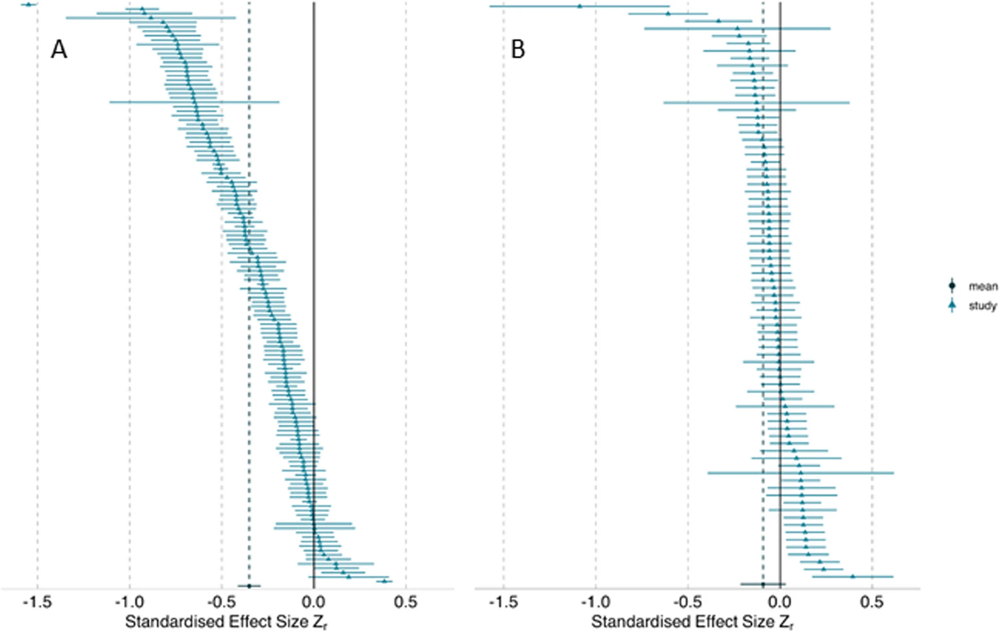

# Block 1: Reproducibility {.unnumbered}


```{r}
#| include: false
source("R/booktem_setup.R")
source("R/my_setup.R")
library(tidyverse)
library(here)
library(knitr)
library(kableExtra)
library(webexercises)
```

> **Materials:** Download all files from the course OSF page: **<https://osf.io/jgeq9/>**

:::{.callout-note}
**Before we start:** Download `celegans_repro_raw.csv` and `celegans_repro_final.csv` from <https://osf.io/jgeq9/> and place them in your working directory. We will load them throughout the session.

**Also install READMEBuilder**, which you'll use in Part 4: `install.packages("pak")`, then `pak::pak("EIvimeyCook/READMEBuilder@development")`.
:::

---

## Part 1: What is reproducibility? {#repro-what}

*⏱ ~20 minutes*

:::{.callout-tip}

**Opening activity: why don't *you* share?** *(post your answer in Slack)*

Think about your most recent or current project.

1. Is the **data** publicly available? Is the **code**?
2. If either is not — why not? Be honest. Too busy? Worried someone will find an error? Not sure how or where? Worried about being scooped? Code too messy to show anyone?

Write down your real reasons. [Gomes et al. (2022)](https://doi.org/10.1098/rspb.2022.1113) surveyed researchers and grouped the barriers people actually report: knowledge gaps, fear of scrutiny, time cost, misaligned career incentives. Keep your list; at the end of the session we will compare it with theirs.

> **Gomes, D.G.E., et al. (2022).** Why don't we share data and code? Perceived barriers and benefits to public archiving practices. *Proceedings of the Royal Society B*, 289, 20221113. <https://doi.org/10.1098/rspb.2022.1113>

:::

### Analytical and computational reproducibility

"Reproducibility" means different things to different people, and the fixes differ too. [Goodman et al. (2016)](https://doi.org/10.1126/scitranslmed.aaf5027) argue for keeping the meanings apart. We use three:

**Analytical reproducibility:** given the same raw data, would a different analyst following the same stated methods reach the same conclusions? Methods sections leave dozens of choices unstated (exclusions, missing values, transformations, random effects). These "researcher degrees of freedom" ([Simmons et al. 2011](https://doi.org/10.1177/0956797611417632)) let honest analysts end up in different places.

**Computational reproducibility:** given the same data *and* code, do you get identical outputs? It's the lower bar, and most of the papers that have been checked still fail it.

**Replicability:** does the finding hold with new data?

:::{.callout-note}
**Shorthand:** Computational reproducibility asks "did you do what your code says?" Analytical reproducibility asks "would a reasonable analyst agree with your approach?" Replicability asks "does it still hold with new data?"
:::

### The replication crisis starts with reproducibility

Large efforts to repeat published studies have found that many findings don't hold up: the **replication crisis**. But you can only check a finding if its analysis can be reproduced first. If the data and code are missing, or don't run, nobody can tell a wrong analysis from a fragile effect.

So how often does that first step work?

:::{.task}
::::{.task-header}
Exercise: estimate the funnel (3 minutes)
::::
::::{.task-container}

[Kellner et al. (2025)](https://doi.org/10.1002/ecy.4475) checked the archived data and code of 497 ecology papers that modelled species distribution and abundance. Write down your estimate for each stage, then post them in Slack (for example `60, 40, 20`) **before** you check them in the boxes. Which stage were you furthest out on, and why do you think that is?

1. What % of the papers archived their data? `r fitb(50, num = TRUE, tol = 10)`
2. What % archived their code? `r fitb(33, num = TRUE, tol = 10)`
3. What % had code that ran without errors? `r fitb(7, num = TRUE, tol = 5)`

::::
:::

`r hide("Reveal the whole pipeline")`

How close were you to 7%? Here's the pipeline across recent surveys:

```{r repro-table}
#| echo: false
#| message: false
library(tidyverse)
library(knitr)
library(kableExtra)

tribble(
  ~stage,                       ~study,                                                            ~pct,
  "Data archived",              "Cooper et al. (2026) — 1,861 BES papers (2017–24)",                "90%",
  "Data archived",              "Kambouris et al. (2024) — 177 EcoEvo meta-analyses (2015–17)",     "75%",
  "Data archived",              "Kellner et al. (2025) — 497 papers, 9 ecology journals (2018–22)", "50%",
  "Code archived",              "Kellner et al. (2025)",                                            "33%",
  "Code archived",              "Cooper et al. (2026)",                                             "31%",
  "Code archived",              "Culina et al. (2020) — ecology",                                   "27%",
  "Code archived",              "Kambouris et al. (2024)",                                          "16%",
  "Code runs without error",    "Trisovic et al. (2022) — 9,078 R files, Harvard Dataverse",        "26% (initial) / 44% (after auto-cleaning)",
  "Code runs without error",    "Kellner et al. (2025)",                                            "7%",
  "Target result reproduced",   "Kambouris et al. (2024) — of 26 papers sharing both",              "27–73% (criterion-dependent)"
) |>
  select(study, pct) |>
  kable(
    col.names = c("Study (sample)", "% of papers"),
    booktabs  = TRUE,
    caption   = "Reproducibility rates at four sequential stages of the analysis pipeline. Percentages are of all sampled papers unless noted; Trisovic et al. (2022) is a percentage of archived R files."
  ) |>
  kable_styling(latex_options = "hold_position",
                bootstrap_options = c("striped", "hover")) |>
  pack_rows(index = c("Data archived"            = 3,
                      "Code archived"            = 4,
                      "Code runs without error"  = 2,
                      "Target result reproduced" = 1))
```

`r unhide()`

- **Code often isn't archived.** In the British Ecological Society journals, 97% of papers that used data archived it, but only 35% of those that used code archived the code ([Cooper et al. 2026](https://doi.org/10.1111/2041-210x.70338)).
- **Archived code often doesn't run.** 74% of more than 9,000 archived R files failed on the first attempt ([Trisovic et al. 2022](https://doi.org/10.1038/s41597-022-01143-6)).
- **Documentation is thin.** About a third of the BES papers had no README.

The funnel is getting wider at the top, but it's still very narrow at the bottom.

:::{.callout-note collapse="true"}
## The details: what each study found

**First, the code is often simply not archived.** [Cooper et al. (2026)](https://doi.org/10.1111/2041-210x.70338), surveying 1,861 papers published 2017–2024 across the seven British Ecological Society journals, found that data archiving has become near-universal: 97% of papers that used data archived it, although that figure is held up by mandatory journal policies rather than community norms. Code is a different story: **only 35% of papers that used code also archived it** (about 31% of all sampled papers). The picture is similar or worse in samples without strong code-sharing mandates: [Kellner et al. (2025)](https://doi.org/10.1002/ecy.4475), across nine ecology journals, found data *and* code available for only 28% of 497 papers; [Kambouris et al. (2024)](https://doi.org/10.1371/journal.pone.0300333) found data and code shared for only 15% of 177 ecology and evolutionary biology meta-analyses published 2015–17.

**Second, even when code is archived, it frequently does not run.** Kellner et al. (2025) attempted to execute the R code accompanying those 497 papers and found that **only 7% of all papers (and only 27% of the papers whose archived data and code could be tested) ran without error**. The most common causes were missing or misnamed files, missing R objects, and reliance on deprecated R packages (17 papers, most of them broken by the retirement of spatial packages such as `rgdal` and `maptools`). [Trisovic et al. (2022)](https://doi.org/10.1038/s41597-022-01143-6), executing more than 9,000 archived R files from the Harvard Dataverse, found 74% failed on the first attempt and 56% still failed after automated cleaning. Kambouris et al. (2024) successfully reproduced the target result from 27–73% of the 26 ecology and evolution meta-analyses that shared both data and code, the range depending on how strictly "successful reproduction" was defined.

**Documentation quality is the other half of the problem.** Cooper et al. (2026) also recorded that around a third of papers had no README to explain their archived files, and that the quality of the READMEs that did exist varied substantially. Sharing rates have crept up over the last decade, from ~27% in [Culina et al. (2020)](https://doi.org/10.1371/journal.pbio.3000763) to ~31–35% in Cooper et al. (2026), but there is no sign that the execution rate has improved: only 7% of papers in Kellner et al. (2025) had code that ran. The funnel may be getting wider at the top, but it is still very narrow at the bottom. Sharing is necessary but not sufficient; archived data and code also have to be *good enough to run and reproduce the result*.
:::

### Quick check

:::::{.quiz}
::::{.quiz-q}
A colleague downloads your archived data and your archived script, runs it, and gets different numbers from the paper. Which kind of reproducibility has failed?

`r mcq(c("Analytical reproducibility", answer = "Computational reproducibility", "Replicability"))`

:::{.quiz-explain}
**Computational reproducibility**: the same data and the same code should give the same outputs. Analytical reproducibility asks whether a *different* analyst, following the same stated methods, would reach the same conclusions; replicability needs new data.
:::
::::

::::{.quiz-q}
Kellner et al. (2025) tried to run the R code from 497 papers that modelled species distribution and abundance. What share of *all* the papers had code that ran without error?

`r longmcq(c(
  answer = "About 7%",
  "About 27%",
  "About 50%",
  "About 75%"
))`

:::{.quiz-explain}
**About 7%.** The 27% is a trap: it is the share of the papers whose data and code could actually be tested. Most papers fell out before that point, because their code was never archived.
:::
::::

::::{.quiz-q}
True or false? Data archiving in the British Ecological Society journals is now close to universal, so the reproducibility problem in ecology is largely solved.

`r torf(FALSE)`

:::{.quiz-explain}
**False.** Cooper et al. (2026) found near-universal *data* archiving, but only 35% of papers that used code archived it, and Kellner et al. (2025) found that only 7% of papers had code that ran.
:::
::::
:::::

---

## Part 2: Many analysts, many answers {#repro-multiverse}

*⏱ ~45 minutes*

### Background: the garden of forking paths

Even honest analysts with the same data and question can reach different answers: [Gelman & Loken (2013)](http://www.stat.columbia.edu/~gelman/research/unpublished/forking.pdf) call it the "garden of forking paths". It isn't p-hacking; each choice just looks inevitable in hindsight. **Many-analysts** studies test this directly ([Silberzahn et al. 2018](https://doi.org/10.1177/2515245917747646); [Gould et al. 2025](https://doi.org/10.1186/s12915-024-02101-x)). Gould et al. gave 174 teams the same ecology datasets, and their estimates spread widely. Reviewers' ratings of each analysis didn't predict which teams landed near the average.

```{r}
#| eval: true
#| echo: false
#| out-width: "80%"
#| fig-cap: "The many-analysts project (Gould et al. 2025)."

```

### You are the analyst

Now you experience this directly. You are given the *C. elegans* reproduction dataset from the course OSF page and a deliberately vague question. Analyse it however seems most reasonable to you.

**The biology:** *C. elegans* is a workhorse model organism in genetics and ageing research. The dataset records each worm's **total offspring** — its lifetime reproductive output — from an experiment crossing two interventions:

| Variable | Meaning |
|---|---|
| `worm_id` | Individual worm identifier |
| `B` | Batch (1–6) — worms run in separate cohorts |
| `strain` | `daf` = daf-2 RNAi (knocks down insulin/IGF-1 signalling; extends lifespan and alters reproduction); `empty_vector` = control RNAi |
| `diet` | `AL` = ad libitum (fed freely); `EODF` = every-other-day fasting (dietary restriction) |
| `TO` | Total offspring — lifetime count of live progeny per worm |

**The question:** *Does daf-2 RNAi affect reproduction?*

That is all you are told. Now analyse it.

:::{.task}
::::{.task-header}
**Individual activity (20 minutes)**
::::

::::{.task-container}

Load `celegans_repro_final.csv` from <https://osf.io/jgeq9/> and answer:
**does daf-2 RNAi affect total offspring?**

You must decide:

- What to do with any unusual values in the data
- Whether to include diet as a covariate or factor
- Whether batch (`B`) should be a fixed or random effect, or ignored
- What statistical model to use (t-test? linear model? mixed model? a count model such as a Poisson or negative-binomial GLMM?)
- Whether to use `TO` as-is or transform it

**Before running anything**, write down your three most important analytical decisions and why. Then run your analysis.

:::{.callout-tip collapse="true"}
## Report your result with this code

```{r emmeans-template}
#| eval: false
# install.packages("emmeans")
library(emmeans)

# Works for lm, lmer, glmer, glmer.nb. regrid() back-transforms to the
# response scale BEFORE the contrast. For identity-link models (lm/lmer)
# it changes nothing; for log-link models (glmer/glmer.nb) it turns the
# default rate ratio into a difference in offspring.
# "trt.vs.ctrl" with ref = "empty_vector" always gives daf - empty_vector,
# whatever order the strain levels are in.
emmeans(model, ~ strain) |>
  regrid() |>
  contrast("trt.vs.ctrl", ref = "empty_vector", adjust = "none") |>
  confint()
#  -> "daf - empty_vector"   estimate   95% CI   in offspring per worm
#     (negative = daf worms had fewer offspring)
#     If the estimate says "nonEst", one strain x diet group is empty:
#     check count(your_data, strain, diet) for a stray label.
#     glmer() and glmer.nb() stop with an error if any TO is negative:
#     decide what to do about that value first.

# A log written in the formula, e.g. lm(log(TO) ~ strain), is detected
# automatically, so the template above works as it is. Only if you logged
# the variable in a separate step, e.g. dat$logTO <- log(dat$TO) and then
# lm(logTO ~ strain), do you need to tell emmeans about the transformation:
emmeans(model, ~ strain) |>
  update(tran = "log") |>
  regrid() |>
  contrast("trt.vs.ctrl", ref = "empty_vector", adjust = "none") |>
  confint()
```

Report the **estimate, the 95% confidence interval, and the units** (offspring per worm). If you prefer a multiplicative effect, report a ratio as well, but at minimum everyone reports `daf - empty_vector` on the response scale so that we are all comparing like with like.
:::

:::{.callout-note collapse="true"}
## Why this code?

Different analysts will pick different models, e.g. a Gaussian linear (or mixed) model, a Poisson GLMM, a negative-binomial GLMM, or a log-transformed linear model. Each one reports the `daf` effect on a different scale:

- A linear model on `TO` returns an **additive difference** — "daf reduces offspring by X per worm."
- A Poisson or NB GLMM with a log link returns a **log-scale coefficient**, which back-transforms to a **rate ratio** — "daf has 0.7× the offspring of controls."
- A linear model on `log(TO)` returns a log-scale difference, which back-transforms to a ratio.

These numbers are not directly comparable between participants. **`emmeans`** puts them all on the response scale (offspring per worm) in two steps: compute the estimated marginal means, then take the contrast between `daf` and `empty_vector`.

We also need everyone to report the difference **the same way round**. The default `"pairwise"` contrast subtracts in factor-level order, so with `empty_vector` as the first (reference) level, as the cleaning script later sets it, you get `empty_vector - daf` and a drop in offspring shows up as a positive number. Leave the levels in alphabetical order instead and you get `daf - empty_vector`. Everyone therefore reports **`daf - empty_vector`**: a negative estimate means daf worms had fewer offspring. The template above fixes this by naming `empty_vector` as the control, which works whatever order your factor levels are in.

For log-link models we use `regrid()` first, which back-transforms the means to the response scale **before** the contrast, so the result is a *difference* in offspring, not the default rate ratio.
:::

**Post one line in Slack:** `estimate, lower, upper, batch`, for example `-48, -70, -26, yes`. That's your daf − empty_vector estimate (negative means daf worms had fewer offspring), its 95% CI, and whether you modelled batch as a random effect. Then post your three key decisions.

::::
:::

### The results

**Before you look at the plot**, write down how many of the group you expect to have found a significant effect of daf-2, then compare.

We'll collect your estimates and draw the class plot live. Until a course's estimates are added, the book shows 16 analyses we ran ourselves on the same file, each with different but defensible choices. Points left of the dashed line mean daf worms had fewer offspring than controls.

```{r many-analysts-demo}
#| echo: false
#| fig-cap: "Results from the many-analysts activity. Each point is one participant's estimate of the daf-2 RNAi effect on C. elegans total offspring (daf minus empty_vector, offspring per worm). Negative values mean daf worms had fewer offspring."
#| fig-height: 4
#| fig-width: 7
# Real class estimates go in files/many_analysts_estimates.csv, one row per
# participant, with columns: estimate, lower, upper (daf - empty_vector,
# offspring per worm) and batch_modelled (TRUE/FALSE).
# Until that file exists, the placeholder below is shown instead.
estimates_file <- here::here("files", "many_analysts_estimates.csv")
real_data <- file.exists(estimates_file)

if (real_data) {
  results <- readr::read_csv(estimates_file, show_col_types = FALSE) |>
    mutate(analyst = row_number(),
           batch_modelled = as.logical(batch_modelled))
} else {
  # Placeholder: 16 analyses we ran ourselves on celegans_repro_final.csv,
  # making different but defensible choices (which unusual values to drop,
  # linear vs log vs count models, batch as a random effect or not).
  results <- tribble(
    ~estimate, ~lower, ~upper, ~batch_modelled,
       -231.0, -511.0,   49.1, FALSE,  # 9999s kept, t-test
       -252.6, -543.0,   38.3, FALSE,  # 9999s kept, strain + diet
       -190.0, -475.0,   95.3, FALSE,  # labels fixed, 9999s kept
        -20.0, -394.0,  354.0, TRUE,   # labels fixed, 9999s kept, mixed model
        -32.1,  -62.0,   -2.3, FALSE,  # labels fixed, log(TO)
          7.8,  -39.3,   54.8, FALSE,  # 9999s dropped, 2850 kept, t-test
         -1.0,  -48.2,   46.1, FALSE,  # 9999s dropped, 2850 kept, strain * diet
         -0.9,  -57.2,   55.3, TRUE,   # 9999s dropped, 2850 kept, mixed model
        -15.6,  -33.0,    1.7, FALSE,  # 9999s dropped, log(TO)
        -19.2,  -34.1,   -4.4, FALSE,  # all bad values dropped, strain + diet
        -19.0,  -37.8,   -0.2, TRUE,   # all bad values dropped, mixed model
        -16.9,  -20.8,  -13.0, TRUE,   # all bad values dropped, Poisson GLMM
        -15.4,  -33.1,    2.4, FALSE,  # also de-duplicated, t-test
        -21.5,  -37.9,   -5.1, FALSE,  # also de-duplicated, strain * diet
        -19.7,  -40.4,    1.1, TRUE,   # also de-duplicated, mixed model
        -19.4,  -35.1,   -3.6, TRUE    # also de-duplicated, negative-binomial GLMM
  ) |>
    mutate(analyst = row_number())
}

results <- results |>
  mutate(
    # "Significant" = the 95% CI excludes zero (for these negative
    # estimates, upper < 0). Coded as a factor with explicit levels so the
    # colour scale stays correct even if every analyst lands on the same
    # side (e.g. all significant).
    sig = factor(upper < 0 | lower > 0,
                 levels = c(FALSE, TRUE),
                 labels = c("Not significant", "Significant")),
    batch = factor(ifelse(batch_modelled, "Batch as random effect", "Batch not modelled"),
                   levels = c("Batch not modelled", "Batch as random effect"))
  )

ggplot(results,
       aes(y = reorder(factor(analyst), estimate),
           x = estimate,
           colour = sig,
           shape  = batch)) +
  geom_vline(xintercept = 0, linetype = "dashed", colour = "grey50") +
  geom_pointrange(aes(xmin = lower, xmax = upper), size = 0.45) +
  scale_colour_manual(
    values = c("Not significant" = "grey60", "Significant" = "#d73027"),
    drop = FALSE, name = "Result") +
  scale_shape_manual(
    values = c("Batch not modelled" = 16, "Batch as random effect" = 17),
    drop = FALSE, name = "Batch") +
  labs(y = "Analyst",
       x = "daf - empty_vector: difference in total offspring per worm\n(estimate ± 95% CI; negative = fewer offspring with daf-2 RNAi)",
       title = "Many analysts, same C. elegans data",
       caption = if (real_data) paste0("Estimates from ", nrow(results), " course participants")
                 else "Placeholder: 16 analyses of the same data by the course team; your estimates appear here once added") +
  theme_classic(base_size = 11) +
  theme(legend.position = "bottom", legend.box = "vertical")
```

:::{.callout-note}
**Debrief (5 minutes):** 

1. How much did the estimates vary? Did anyone get a non-significant result while others got significant?
2. Who modelled batch as a random effect? Did that change the conclusion?
3. Who used a count model (Poisson / negative-binomial) vs a plain linear model? Does the model choice matter here?
4. What would the published literature look like if each of you submitted your analysis independently?
:::

### Why this matters

That spread comes from underspecified methods, not noise. The fix is **transparency**: record every decision so a reader can judge it. That's where TADA! ([Ivimey-Cook et al. 2025](https://doi.org/10.32942/X2D93K)) and the SORTEE guidelines ([Pick et al. 2026](https://doi.org/10.24072/pcjournal.687)) come in, and it's what code review (this afternoon) is designed to catch.

### Quick check

:::::{.quiz}
::::{.quiz-q}
Gelman & Loken's "garden of forking paths" describes:

`r longmcq(c(
  "Analysts deliberately trying models until one gives p < 0.05",
  answer = "Honest analysts each taking one of many defensible routes through the analysis, with the route only looking inevitable afterwards",
  "Random sampling error between independent experiments",
  "Errors introduced when code is copied between projects"
))`

:::{.quiz-explain}
No deliberate p-hacking is needed. Honest analysts make one reasonable choice after another, and the route they took looks like the only one in hindsight, even though many others were just as defensible.
:::
::::

::::{.quiz-q}
True or false? In Gould et al. (2025), analyses that peer reviewers rated highly produced estimates closer to the average.

`r torf(FALSE)`

:::{.quiz-explain}
**False.** Reviewers' ratings did not predict how far a team's estimate lay from the average: well-rated analyses were as spread out as poorly rated ones.
:::
::::

::::{.quiz-q}
Your `"pairwise"` contrast prints `empty_vector - daf = 45`. What number should you post in Slack?

`r fitb(-45, num = TRUE)`

:::{.quiz-explain}
**−45.** Everyone reports `daf - empty_vector`, so flip the sign. A positive `empty_vector - daf` of 45 means daf worms had 45 *fewer* offspring.
:::
::::

::::{.quiz-q}
You fit a negative-binomial GLMM (log link) and run `emmeans(model, ~ strain) |> contrast("trt.vs.ctrl", ref = "empty_vector")`, forgetting `regrid()`. What does the contrast compare?

`r longmcq(c(
  "The difference in offspring per worm, the same as with regrid()",
  answer = "The strains on the log scale, so back-transformed it is a ratio of offspring, not a difference",
  "The raw coefficients without any adjustment for diet",
  "Nothing: emmeans stops with an error for log-link models"
))`

:::{.quiz-explain}
Without `regrid()` the contrast is worked out on the log scale. A difference of logs back-transforms to a *ratio* ("daf worms have 0.7× the offspring"), not a difference ("45 fewer"). `regrid()` moves to the response scale first.
:::
::::
:::::

---

## Part 3: Diagnosing a bad dataset and script {#repro-diagnosis}

*⏱ ~30 minutes*

Now we look systematically at the raw data file. `celegans_repro_raw.csv` contains the same experiment but before any cleaning. Every problem in it is a real type of problem that appears in published archives.

### Data quality audit

```{r load-raw}
#| eval: false
library(tidyverse)

# Load the raw data — download from https://osf.io/jgeq9/
dat_raw <- read_csv("celegans_repro_raw.csv",
                    trim_ws = FALSE)  # keep spaces exactly as typed, so none are hidden

# First look
dim(dat_raw)
glimpse(dat_raw)
summary(dat_raw)
```

```{r explore-raw}
#| eval: false
# Check each variable for problems

# strain values
dat_raw |> count(strain)

# Diet values
dat_raw |> count(diet)

# TO (total offspring) range
dat_raw |>
  summarise(min = min(TO, na.rm = TRUE),
            max = max(TO, na.rm = TRUE),
            n_na = sum(is.na(TO)))

# worm_id problems
dat_raw |> filter(is.na(worm_id))

# Duplicate rows?
dat_raw |>
  filter(!is.na(worm_id)) |>
  group_by(worm_id, B) |>
  filter(n() > 1) |>
  arrange(worm_id)

# Rows where everything is NA except TO
dat_raw |> filter(is.na(strain))
```

:::{.task}
::::{.task-header}
**Exercise: data audit (10 minutes)**
::::

::::{.task-container}

The raw file contains **nine** data quality problems. Run the code above and, for each problem you find, write one line: **the problem, the column, and what it would do to an analysis** (for example: *`TO` has −46; offspring can't be negative; it drags the daf/EODF mean down*). Post your list in Slack, then check it against the solution.

Hints: capitalisation, spaces, impossible values, codes pretending to be numbers, rows that shouldn't be there.

::::
:::

`r hide("Solution")`

Here is what you should have found:

```{r data-problems}
#| echo: false
tribble(
  ~`#`, ~Problem,                                            ~Column,      ~Detail,                                                                                 ~`Why it matters`,
  "1",  "Mixed capitalisation in strain",                  "`strain`", "`daf` (n=117) and `DAF` (n=24) — same condition, will be treated as two groups",        "Inflates group count; DAF worms silently excluded or double-counted",
  "2",  "Trailing whitespace in strain",                   "`strain`", "`empty_vector ` (with trailing space) — will not match `empty_vector`",            "Three worms silently dropped or form a phantom third group",
  "3",  "Mixed capitalisation in diet",                       "`diet`",      "`EODF` (n=144) and `eodf` (n=27) — same condition, two labels",                        "Same problem as issue 1 — artificially splits dietary groups",
  "4",  "Impossible negative offspring count",                "`TO`",        "worm_id 112, B=5, daf, EODF: TO = -46",                                                "Biological impossibility (offspring cannot be negative); distorts means and any model",
  "5",  "Implausible extreme offspring count",                "`TO`",        "worm_id 47, B=4, daf, AL: TO = 2850 — likely a typo for 285 (brood size is typically ~250–350)", "Will massively inflate mean offspring in the daf/AL group",
  "6",  "Sentinel value 9999 not documented",                 "`TO`",        "Three worms with TO = 9999 — an undocumented code, almost certainly 'offspring not recorded'", "If treated as a real offspring count it dramatically inflates the outcome",
  "7",  "Missing worm_id",                                    "`worm_id`",   "Two rows in B=1, daf, EODF have worm_id = NA",                                         "Cannot link these observations back to individual worms",
  "8",  "Junk rows (worm_id 501–506)",                        "All",         "Six rows where B, strain, and diet are all NA — only TO has a value",               "Probably data entry artefacts; will cause errors in grouped summaries",
  "9",  "Duplicate rows in batch 2",                          "All",         "worm_ids 13–24 and 73–84 appear twice; some empty_vector batch 2 rows also doubled",   "Artificially inflates sample size and gives false precision"
) |>
  kbl(booktabs = TRUE,
      caption = "Data quality problems in celegans_repro_raw.csv") |>
  kable_styling(full_width = TRUE, bootstrap_options = c("striped","hover"))
```

`r unhide()`

:::{.callout-note}

Issue 6 (TO = 9999) is a good example of a sentinel value: a number used to encode a special meaning, here almost certainly "offspring not recorded" (the count is missing for that worm). Sentinel codes like 9999, -999, or 0-for-missing are common in real data files; they are legitimate only if documented in a codebook and handled explicitly in code. If someone runs `mean(TO)` on the raw data without knowing what 9999 means, their result will be completely wrong.
:::

:::{.task}
::::{.task-header}
**Activity: compare raw and final (5 minutes)**
::::

::::{.task-container}

Now load `celegans_repro_final.csv` and compare it to the raw file:

```{r compare-files}
#| eval: false
dat_raw   <- read_csv("celegans_repro_raw.csv", trim_ws = FALSE)
dat_final <- read_csv("celegans_repro_final.csv", trim_ws = FALSE)

# How many rows differ?
cat("Raw rows:", nrow(dat_raw), "\n")
cat("Final rows:", nrow(dat_final), "\n")
cat("Difference:", nrow(dat_raw) - nrow(dat_final), "\n")

# What strain values remain in each?
cat("\nRaw strains:\n")
print(count(dat_raw, strain))

cat("\nFinal strains:\n")
print(count(dat_final, strain))

# Does the final still contain the problematic TO values?
cat("\nFinal TO range:\n")
dat_final |> summarise(min = min(TO, na.rm = TRUE),
                        max = max(TO, na.rm = TRUE))
```

In Slack: does the final file still contain TO = -46? TO = 2850? What does this tell you about the cleaning that was done?

::::
:::

The "final" file is 48 rows shorter because the whole of batch 3, where every `DAF` row was, has gone, with no note of why. Nothing else was fixed: the duplicates, −46, 2850 and the 9999s are all still there. Partial, undocumented cleaning like this is common, and it means every analyst still has to decide for themselves.

### Quick check

:::::{.quiz}
::::{.quiz-q}
`dat_raw |> count(strain)` lists `daf`, `DAF`, `empty_vector` and `empty_vector ` (with a trailing space). How many genuine strains are there?

`r fitb(2, num = TRUE)`

:::{.quiz-explain}
**Two**: daf and empty_vector. `DAF` is a capitalisation error and `empty_vector ` has a trailing space, but R treats every spelling as a separate group until you standardise them.
:::
::::

::::{.quiz-q}
Three worms have `TO = 9999`. What is the best way to handle them?

`r longmcq(c(
  "Keep them: they are real counts and removing data is never justified",
  "Replace them with 0, because the worms produced no recorded offspring",
  answer = "Treat them as missing: document the code in a codebook, exclude them in the script and log how many were removed",
  "Delete the rows by hand in the CSV before loading it"
))`

:::{.quiz-explain}
9999 is a code for "not recorded", not a count. Keeping it inflates the mean enormously, replacing it with 0 invents data, and editing the CSV by hand leaves no record. Document it, exclude it in code, and log the count.
:::
::::

::::{.quiz-q}
True or false? `celegans_repro_final.csv` has already been cleaned, so it is safe to analyse as it is.

`r torf(FALSE)`

:::{.quiz-explain}
**False.** The "final" file still contains TO = −46 and TO = 2850, so different analysts will still handle them differently. Partial cleaning like this is common in real archives.
:::
::::
:::::

---

## Part 4: Fixing it with structure, cleaning and a README {#repro-fix}

*⏱ ~50 minutes*

### Step 1: Set up the project structure

Most analysis projects do not start tidy. Here is a very typical folder structure for this *C. elegans* experiment, with everything dumped in a single directory:

```
REPROCODE_ANALYSIS/
├── celegans_repro_raw.csv     # raw data
├── celegans_repro_final.csv   # a "cleaned" copy — but cleaned how?
├── ANALYSIS.R                 # the analysis script
├── old_code.R                 # an earlier version, still sitting here
├── celegans_analysis.Rmd      # a write-up
├── celegans_analysis.html     # the rendered write-up
├── final.jpeg
├── finalplot.jpeg             # "finalplot" — so which figure is current?
├── ExtractedFigure1.png
├── Flowchart.jpg
└── 4Rs.jpg
```

**Exercise (3 minutes):** list every problem you can see in this folder, and for each one, say what you would change (move, rename, delete or add). Post your list in Slack, then compare it with ours.

`r hide("Our list")`

- **Raw and processed data sit side by side.** Which file is safe to overwrite, and how was `celegans_repro_final.csv` made?
- **`old_code.R` is dead code**, waiting for a collaborator to run it by mistake.
- **Five loose images**: outputs mixed in with the source, with `final` and `finalplot` doing the job of version control.
- **No README**: nothing says what to run, or in what order.

`r unhide()`

This is a normal project; most look like this. (We review `ANALYSIS.R` itself this afternoon; for now we fix the *structure*.)

Aim instead for a few standard folders that separate inputs, code and outputs:

```{r setup-project}
#| eval: false
library(tidyverse)
library(here)

# Create a proper folder structure
dirs <- c("data/raw", "data/processed", "analysis", "figures", "results")
for (d in dirs) {
  dir.create(d, recursive = TRUE, showWarnings = FALSE)
}

# Copy the raw data file into data/raw/ — never modify this copy
file.copy("celegans_repro_raw.csv",
          here("data", "raw", "celegans_repro_raw.csv"))

cat("Project structure:\n")
list.files(recursive = TRUE, include.dirs = TRUE)
```

### Step 2: A documented cleaning script

```{r cleaning-script}
#| eval: false
# analysis/01_data_cleaning.R
# Author:   [your name]
# Date:     [today]
# Purpose:  Clean raw C. elegans reproduction data for daf-2 × diet experiment
#
# Study:    Effect of daf-2 RNAi and dietary restriction on total offspring
# Organism: Caenorhabditis elegans (N2 background)
# Design:   2 strains (daf-2 RNAi vs empty_vector control) ×
#           2 diets (AL = ad libitum; EODF = every-other-day fasting)
#           6 batches (B); multiple worms per batch
#
# Variables:
#   worm_id   — individual worm ID (integer)
#   B         — batch number (1–6); should be treated as random effect
#   strain    — "daf" = daf-2 RNAi; "empty_vector" = control
#   diet      — "AL" = ad libitum; "EODF" = every-other-day fasting
#   TO        — total offspring (count); 9999 = undocumented code for "not recorded"
#
# Input:  data/raw/celegans_repro_raw.csv
# Output: data/processed/celegans_clean.csv
#         results/exclusion_log.csv

library(tidyverse)
library(here)

# ── 1. Load ───────────────────────────────────────────────────────────────────
dat_raw <- read_csv(here("data", "raw", "celegans_repro_raw.csv"),
                    show_col_types = FALSE)
cat("Raw data:", nrow(dat_raw), "rows\n")

# ── 2. Standardise factor levels (case and whitespace) ────────────────────────
# strain: "DAF" is a capitalisation error — same as "daf"
# "empty_vector " has trailing whitespace — same as "empty_vector"
# diet: "eodf" is a capitalisation error — same as "EODF"
dat_std <- dat_raw |>
  mutate(
    strain = str_trim(str_to_lower(strain)),
    diet   = str_trim(str_to_upper(diet))
  )

cat("After standardisation — strain values:\n")
print(count(dat_std, strain))
cat("After standardisation — diet values:\n")
print(count(dat_std, diet))

# ── 3. Count structural junk rows ────────────────────────────────────────────
# worm_ids 501–506: strain and diet both NA — data entry artefacts
# (count with the same rule we use to remove them in step 4)
n_junk <- sum(is.na(dat_std$strain) & is.na(dat_std$diet))
cat("Junk rows (no strain or diet):", n_junk, "\n")

# ── 4. Remove junk and duplicate rows ────────────────────────────────────────
dat_std <- dat_std |>
  filter(!(is.na(strain) & is.na(diet)))

# Batch 2 rows appear duplicated — retain first occurrence only.
# Rows with a missing worm_id are never treated as duplicates: R would count
# two unidentified worms as the "same" worm and silently drop one.
n_before_dedup <- nrow(dat_std)
dat_std <- dat_std |>
  filter(is.na(worm_id) | !duplicated(pick(worm_id, B, strain, diet)))
n_removed_dupes <- n_before_dedup - nrow(dat_std)
cat("Duplicate rows removed:", n_removed_dupes, "\n")

# ── 5. Data-quality exclusions and flags ─────────────────────────────────────
# Exclusion 1: TO = 9999 — undocumented sentinel meaning "offspring not
# recorded". These are missing values, not real counts of zero; we exclude
# them and record the count so the loss is visible in the methods section.
n_missing <- sum(dat_std$TO == 9999, na.rm = TRUE)
cat("Missing offspring (TO = 9999):", n_missing, "excluded\n")

# Exclusion 2: TO < 0 — biologically impossible (offspring cannot be negative)
# worm_id 112, B=5, daf, EODF: TO = -46 — likely data entry error
n_neg <- sum(dat_std$TO < 0, na.rm = TRUE)
cat("Negative TO values:", n_neg, "\n")

# Flag 1: TO > 1000 and < 9999 — implausible (C. elegans brood size is
# typically ~250–350; values in the thousands are not credible)
# worm_id 47, B=4, daf, AL: TO = 2850 — likely a typo for 285
# Flag, don't remove: the row stays in the data, marked flag_implausible,
# until the value is checked against the original data sheet
n_implausible <- sum(dat_std$TO > 1000 & dat_std$TO < 9999, na.rm = TRUE)
cat("Implausible TO values (>1000, <9999):", n_implausible,
    "— flagged, kept pending verification\n")

dat_clean <- dat_std |>
  filter(
    TO != 9999,          # Exclusion 1: missing (9999 sentinel)
    TO >= 0              # Exclusion 2: impossible
  ) |>
  mutate(
    # Flag 1: kept, but marked so the analysis can leave it out visibly
    flag_implausible = TO > 1000,
    # Explicit factor with reference levels
    strain = factor(strain, levels = c("empty_vector", "daf")),
    diet   = factor(diet, levels = c("AL", "EODF")),
    B      = factor(B)  # batch as factor for random effect
  )

cat("\nFinal clean dataset:", nrow(dat_clean), "worms\n")

# ── 6. Save ───────────────────────────────────────────────────────────────────
write_csv(dat_clean, here("data", "processed", "celegans_clean.csv"))

exclusion_log <- tribble(
  ~Criterion,                                 ~N,              ~Action,
  "Junk rows (no strain or diet)",            n_junk,          "Excluded",
  "Duplicate rows removed",                   n_removed_dupes, "Excluded",
  "Missing offspring (TO = 9999)",            n_missing,       "Excluded",
  "Impossible count (TO < 0)",                n_neg,           "Excluded",
  "Implausible count (TO > 1000, not 9999)",  n_implausible,   "Flagged, kept"
)
write_csv(exclusion_log, here("results", "exclusion_log.csv"))
print(exclusion_log)
```

:::{.task}
::::{.task-header}
**Activity: run and inspect the cleaning script (8 minutes)**
::::

::::{.task-container}

Copy this script into `analysis/01_data_cleaning.R` in your project and run it.

Then answer in Slack:

1. How many worms are in the final clean dataset?
2. Looking at the exclusion log: which exclusion removes the most observations?
3. The script keeps TO = 2850 but marks it in a `flag_implausible` column, rather than deleting it or keeping it unmarked. Why is that the right choice for reproducibility? Where does the decision to leave it out of the analysis now live?
4. Read through the cleaning script, do you understand what it is doing? 
::::

:::

### TADA!: the framework behind a reviewable script

The cleaning script you just ran is short, but several of its choices were deliberate: the header block, the `here()` calls, the explicit exclusion log and the section dividers. These map onto a small set of principles for analytical code sharing that we use throughout the rest of this course.

**TADA!** (*Transferable, Available, Documented, Annotated*) is the minimum an author needs to do to share working analysis code with a paper:

| | Principle | In one line | In practice |
|---|---|---|---|
| **T** | Transferable | Anyone can open and run it, unaltered | Plain `.R` files; relative paths (RStudio project + `here()`); one project folder archived whole; a colleague test-runs it |
| **A** | Available | Archived publicly, with a DOI cited in the paper | Zenodo or Figshare (linked to GitHub releases), or Software Heritage; cite the DOI of the version used. GitHub alone, "on request" or Dropbox don't count |
| **D** | Documented | A README says how to reuse it | Authors and contact; R and package versions; where the data are; what each file does, run order and run time; a licence |
| **A** | Annotated | Comments say what and why | A header per script; per-chunk comments saying what, why, and which result in the paper; section markers |

TADA! maps onto the FAIR principles and is how authors meet Stage 3 of the SORTEE guidelines. `renv` and containers help further, but go beyond its minimum.

:::{.callout-note collapse="true"}
## The details: each principle in full

Ivimey-Cook et al. (2025) propose **TADA!** (*Transferable, Available, Documented, Annotated*): the minimum an author needs to do to share functional analysis code with a paper. The guidelines are built with the FAIR principles in mind, and each letter maps onto one or more of them: Transferable onto *Interoperable*, Available onto *Findable* and *Accessible*, and Documented and Annotated onto *Reusable*. Following TADA! is also how an author meets **Stage 3** of the SORTEE data-editor guidelines (Pick et al. 2026), which we come back to in Part 5. The four letters:

- **T: Transferable.** Anyone can open, view and run the code without converting or altering it.
  - Save code as a plain code file (`.R`, `.py`), never inside a Word document or PDF: copying code out of those changes characters and breaks it.
  - Use relative file paths, never absolute ones or `setwd()`. An RStudio project together with `here()` is the recommended way.
  - Keep data and code in one project folder with sub-folders (e.g. `data/raw/`, `data/processed/`, `code/`, `figures/`), and archive that whole folder so the paths still work.
  - Before archiving, ask a colleague to run the code on their machine.

  Dependency managers such as `renv`, workflow managers and containers help reproducibility further, but the paper treats them as beyond TADA!'s minimum.
- **A: Available.** The code is publicly archived with a persistent identifier, such as a DOI, that is cited in the paper.
  - Use **Zenodo** or **Figshare**. Both can connect to a GitHub repository and archive each release automatically, with a DOI for every version. **Software Heritage** is another option.
  - GitHub (and GitLab, Bitbucket and similar) is for *developing* code, not archiving it: it gives no DOI, and files can be changed or deleted after publication.
  - Cite the DOI of the *version* of the code that produced the paper's results.

  "Available on request" and a personal Dropbox link do not count: the first decays with careers, the second with subscriptions.
- **D: Documented.** A README tells a reader what they need to reuse the code:
  - the authors, with contact details (these can be anonymised for double-blind review), and the title, abstract and funders of the paper;
  - the software and its version (e.g. R 4.5.2), and **every package with its version number**, for example as a saved `sessionInfo()` file;
  - where the data are, ideally with their DOI;
  - what each file contains, the order to run them, what data they need, what they produce, and how long they take to run;
  - a **licence** saying how others may use the code: typically **MIT** (permissive) or **GPL** (derivatives must use the same licence). [choosealicense.com](https://choosealicense.com/) helps you pick one.

  We'll build a README in the next section using READMEBuilder, which the TADA! paper recommends.
- **A: Annotated.** Comments inside the code explain what it does and why.
  - Start each script with a header saying what it does and what it produces.
  - Annotate chunks of code rather than every line: what the chunk does, *why*, and **which result in the paper it produces** (e.g. `# Poisson GLM of offspring by strain; results in Table 2`).
  - Section markers such as `# ---- 1. Load ----` make the script collapsible and easier to navigate.
  - Code embedded in a Quarto or R Markdown document alongside its explanation counts too.

  The cleaning script's exclusion comments (*"TO = 9999: undocumented sentinel meaning 'offspring not recorded'… we exclude them and record the count so the loss is visible in the methods section"*) are annotation; `# read the data` next to `read_csv()` is not.
:::

All four are needed: perfect comments won't save a hard-coded path, and portable code is no use if nobody knows which file to run first. TADA! also comes before code review, because a reviewer can only check code they can open, run and understand (this afternoon's four Rs, [Ivimey-Cook et al. 2023](https://doi.org/10.1111/jeb.14230)).

:::{.callout-tip}
**The TADA Wiki.** For practical, step-by-step help with each letter, use the **TADA Wiki**: <https://eivimeycook.github.io/TADA-Wiki/>. It has a *Start here* route to getting your code ready to submit, a chapter for each principle, and guidance on licences, choosing a repository, the SORTEE guidelines and code review, with examples in R and Python.
:::

:::{.task}
::::{.task-header}
**Activity: map TADA! onto the cleaning script (5 minutes)**
::::

::::{.task-container}

Scroll back to `01_data_cleaning.R`. Identify one specific line or block that demonstrates each of the four TADA! principles. One of them is only *partially* present in the script as it stands — which, and what's missing? Type your answer in Slack.

::::
:::

`r hide("Solution")`

**Available** is the partial one. The script is *written* in a way that could be archived, but on its own a script is not Available: that requires depositing the project in Zenodo or Figshare, with a DOI that the paper cites. We close that gap in Part 5.

**Documented** is only partly there too. The header describes the data, but nothing yet records the package versions or a licence. Those belong in the README, which you build next.

`r unhide()`

### Step 3: Build the README with READMEBuilder

A README is the single most useful file in an archive for anyone trying to reuse it, and it is also the file that gets skipped under deadline pressure. Writing one from a blank page is hard; filling in a structured form is not.

[**READMEBuilder**](https://github.com/EIvimeyCook/READMEBuilder) provides that form. It turns a project folder into a `README.md`: it summarises every data file column by column, records the script run order, detects package versions and maps the folder. You add what only you know, such as what the columns mean. It runs on your own computer, so nothing is uploaded.

:::{.callout-note collapse="true"}
## The six tabs

1. **Project Info:** title, description, abstract, instructions, DOIs, citation, authors (with ORCIDs), affiliations, contact, funders and acknowledgements. Code and data get **separate licences**, with one-click buttons for the usual choices (MIT, Apache 2.0 or GPL-3.0 for code; CC0 or CC BY 4.0 for data).
2. **Files:** load the project folder. The app draws a map of the folder and summarises every data file column by column (type, range, levels, missing values). You add a description of each column, and units for numeric ones.
3. **Script Order:** put the scripts in the order they should be run, with a line on what each one does.
4. **R Packages:** scans your scripts for every package they use and records its version and the R version. If the folder has an `renv.lock`, the versions come from there, and a **Source** column says where each version came from.
5. **Models (optional):** for each analysis, the outcome and predictors, and where the method is described, where the results are reported, and which script and line produce them.
6. **Preview & Export:** a live preview, and a one-click download of `README.md`.

Because the structure is fixed, every README it produces covers what TADA!'s *Documented* principle asks for, and you can re-open a README it made earlier and keep editing it.
:::

:::{.callout-note}
## Installing and running READMEBuilder

READMEBuilder is not on CRAN. Install the development version from GitHub (it has the latest features and fixes; you only need to do this once):

```{r}
#| eval: false
install.packages("pak")
pak::pak("EIvimeyCook/READMEBuilder@development")

packageVersion("READMEBuilder")   # 0.2.1 is the development version
```

Then open your project (the RStudio project from Step 1) and start the app with that folder already loaded:

```{r}
#| eval: false
library(READMEBuilder)
build_readme(here::here())                     # open the app on this project
build_readme(here::here(), edit_readme = TRUE)  # carry on editing a README it made earlier
```

`build_readme()` on its own opens an empty form: then click **Use working directory** on the **Files** tab. The **How to use this app** button at the bottom of the left-hand menu explains each tab. Install `jsonlite` too if you want versions read from an `renv.lock`.
:::

:::{.task}
::::{.task-header}
**Activity: build the README (15 minutes)**
::::

::::{.task-container}

Run `build_readme(here::here())` from your C. elegans project and work through the tabs. The data dictionary takes the longest, so spend most of your time there: on the **Files** tab, can you describe every column of `celegans_repro_raw.csv`?

Look at the automatic summary of `TO` while you are there. Its range runs from −46 to 9999: the app has found two of the audit's problems for you. Say what they are in the file's description.

If you cannot get the app running, write the README by hand. The skeleton below follows the same sections, in the same order, as the app's export.

````markdown
# C. elegans strain × diet reproduction experiment

## Description
[2–3 sentences: the experiment, the question it addresses, and what this
archive contains]

## Instructions
Run the scripts in the order listed under **Code**.
Total run time: about [X] minutes.

## Authors
- [Name] ([ORCID])

## Affiliations
- [Affiliation]

## Contact
[contact email]

## Funding
- [Funder, grant number]

## Citation
> [The paper: authors, year, title, journal, DOI]

## License
- **Code:** licensed under MIT.
- **Data:** licensed under CC-BY-4.0.

## Directory Structure
```text
celegans-project/
├── analysis/
│   └── 01_data_cleaning.R
├── data/
│   ├── processed/
│   │   └── celegans_clean.csv
│   └── raw/
│       └── celegans_repro_raw.csv
├── figures/
├── results/
│   └── exclusion_log.csv
└── README.md
```

## Data Files

### `data/raw/celegans_repro_raw.csv`

[What one row is, and the known problems in this raw file (from your audit)]

**Dimensions:** [rows] rows × 5 columns

**Variables:**

| Column | Type | Description | Units | Summary |
| :----- | :--- | :---------- | :---- | :------ |
| `worm_id` | numeric | | | [the app fills this in] |
| `B` | numeric | Batch (1–6) | | |
| `strain` | categorical | | | |
| `diet` | categorical | | | |
| `TO` | numeric | | offspring | range −46–9999 |

## Code
Scripts should be run in the following order:

1. **`analysis/01_data_cleaning.R`**

   [What it does and what it produces]

## R Environment
**R version:** [version]

| Package | Version | Source |
| :------ | :------ | :----- |
| `tidyverse` | [version] | installed |
| `here` | [version] | installed |
````

Export the `README.md` into your project root, then paste your description of `celegans_repro_raw.csv` and your completed variables table in Slack.

::::
:::

### Quick check

:::::{.quiz}
::::{.quiz-q}
What does `str_trim(str_to_lower(" DAF "))` return?

`r fitb(c("daf", '"daf"'))`

:::{.quiz-explain}
**"daf".** `str_to_lower()` turns `" DAF "` into `" daf "`, then `str_trim()` removes the spaces at both ends.
:::
::::

::::{.quiz-q}
The cleaning script keeps rows with `filter(TO != 9999, TO >= 0)`. What happens to a row where `TO` is `NA`?

`r longmcq(c(
  "It is kept, because NA is not equal to 9999",
  answer = "It is dropped, because filter() keeps only rows where every condition is TRUE, and NA != 9999 gives NA",
  "filter() stops with an error",
  "It is kept, and TO is set to 0"
))`

:::{.quiz-explain}
**It is dropped.** `NA != 9999` gives `NA`, not `TRUE`, and `filter()` keeps only rows where every condition is `TRUE`. The row disappears without a message and without a line in the exclusion log, so if your data could contain `NA` counts, count and log them explicitly.
:::
::::

::::{.quiz-q}
You put your code on GitHub and paste the repository URL into the paper. Which TADA! letter is still not met?

`r mcq(c("Transferable", answer = "Available", "Documented", "Annotated"))`

:::{.quiz-explain}
**Available.** GitHub is for developing code: it gives no DOI, and files can be changed or deleted after publication. Archive a release on Zenodo or Figshare and cite that version's DOI.
:::
::::

::::{.quiz-q}
Which comment is annotation in the TADA! sense?

`r longmcq(c(
  "# read the data",
  "# load packages",
  answer = "# Exclude TO = 9999 (code for 'not recorded'); count logged for the methods and Table S1",
  "# done!"
))`

:::{.quiz-explain}
Good annotation says what a chunk does, **why**, and which result it produces. `# read the data` only repeats what `read_csv()` already says.
:::
::::

::::{.quiz-q}
True or false? You must use `renv` to meet TADA!'s *Transferable* principle.

`r torf(FALSE)`

:::{.quiz-explain}
**False.** Transferable needs plain code files, relative paths and one project folder archived together. TADA! treats `renv` and containers as helpful extras beyond its minimum.
:::
::::
:::::

---

## Part 5: The SORTEE Guidelines and archiving {#repro-sortee}

*⏱ ~15 minutes*

TADA! is the floor; the SORTEE guidelines ([Pick et al. 2026](https://doi.org/10.24072/pcjournal.687)) build full quality control on top of it. For every archive:

- **Add a licence.** Without one, all rights are reserved, so nobody can legally reuse your work. Typically [CC BY 4.0](https://creativecommons.org/licenses/by/4.0/) for data and [MIT](https://opensource.org/licenses/MIT) (or GPL) for code; they can differ within one archive. Dryad only offers CC0, which doesn't suit code. [choosealicense.com](https://choosealicense.com/) helps.
- **Archive with a DOI.** OSF pages and GitHub repositories can be edited or deleted. Link GitHub to Zenodo or Figshare so every release gets its own DOI (Software Heritage works too), and cite the version that produced your results.

### Pre-submission checklist

```{r final-checklist}
#| echo: false
tibble(
  Done = "☐",
  Item = c(
    "T: code saved as .R files (not inside Word or PDF)",
    "T: relative file paths (RStudio project + here()); data and code in one project folder, archived together",
    "T: a colleague has run the code on their machine",
    "A: code archived in Zenodo or Figshare (or Software Heritage) with a DOI",
    "A: the DOI of the version that produced the results is cited in the paper",
    "D: README with authors and contact, paper title, data DOI, file descriptions, run order and run time",
    "D: R version and every package version recorded (README, renv.lock or saved sessionInfo())",
    "D: licence stated for the code (MIT / GPL) and for the data (CC BY / CC0)",
    "A: each script has a header saying what it does and produces",
    "A: chunk comments say what, why, and which result in the paper each produces",
    "Raw data preserved unmodified in data/raw/",
    "All exclusion criteria coded and counts saved to exclusion_log.csv",
    "Sentinel values (e.g. 9999) documented in a codebook, not silently dropped",
    "Data archived with a persistent DOI",
    "Scripts run in sequence from a fresh session without errors",
    "Code reviewed by at least one other person before submission"
  )
) |>
  kbl(booktabs = TRUE,
      caption = "Pre-submission checklist: TADA! + SORTEE Guidelines") |>
  kable_styling(full_width = TRUE, bootstrap_options = c("striped","hover")) |>
  pack_rows("TADA!: Transferable", 1, 3) |>
  pack_rows("TADA!: Available", 4, 5) |>
  pack_rows("TADA!: Documented", 6, 8) |>
  pack_rows("TADA!: Annotated", 9, 10) |>
  pack_rows("Data (SORTEE)", 11, 14) |>
  pack_rows("Code review", 15, 16)
```

:::{.task}
::::{.task-header}
**Exercise: audit your own project (5 minutes)**
::::

::::{.task-container}

Think of the project you described in the opening activity. Go through the checklist above and tick every item that project meets **today**.

Post in Slack:

1. Your score out of 16.
2. The one unticked item you'll fix first, and roughly how long it will take.

Hold on to this for the closing reflection. Look back at the reason you gave this morning for not sharing your data or code: would fixing the item you just picked remove that reason? If not, which item would?

::::
:::

### Quick check

:::::{.quiz}
::::{.quiz-q}
True or false? Code on a public website with no licence is free for anyone to reuse.

`r torf(FALSE)`

:::{.quiz-explain}
**False.** Without a licence all rights are reserved by default, so others cannot legally reuse your code, even though they can see it.
:::
::::

::::{.quiz-q}
Which of these gives your code a permanent record with a DOI for the exact version used in the paper?

`r mcq(c("A public OSF page", "A GitHub repository", answer = "A Zenodo release", "A shared Dropbox folder"))`

:::{.quiz-explain}
**A Zenodo release** gets a DOI for that exact version, and the record cannot be quietly changed. An OSF page, a GitHub repository and a Dropbox folder can all be edited or deleted later.
:::
::::

::::{.quiz-q}
You archive your data and code together on Dryad. Which licence will they carry?

`r mcq(c(answer = "CC0", "CC BY 4.0", "MIT", "GPL"))`

:::{.quiz-explain}
**CC0.** Dryad releases everything it holds under CC0, a public-domain waiver, which does not suit code. Archive the code separately (on Zenodo, for example) under MIT or GPL.
:::
::::
:::::

:::{.callout-tip}
**Closing reflection** *(post in Slack)*

Return to your opening activity — the barriers you listed for not sharing data and code. Look at them again alongside the benefits and reframings in Gomes et al. (2022). Which barrier is the real blocker for you?

Complete this sentence: "Before my next submission, the one thing I will do differently is..."
:::

---

## Glossary

```{r glossary-repro}
#| echo: false
tribble(
  ~Term,                          ~Definition,
  "Analytical reproducibility",   "Different analysts following the same stated methods reach the same conclusions",
  "Computational reproducibility","The same code and data produce identical outputs when run by another person",
  "Many analysts paradigm",       "Multiple independent teams analyse the same dataset to quantify analytical variability",
  "Researcher degrees of freedom","The space of defensible analytical decisions in an underspecified analysis (Simmons et al. 2011)",
  "Garden of forking paths",      "The metaphor for multiple valid analytical paths through any dataset (Gelman & Loken 2013)",
  "Sentinel value",               "A special number used to encode meaning, e.g. 9999 standing in for 'not recorded'; must be documented and handled explicitly",
  "TADA!",                        "Transferable, Available, Documented, Annotated: the minimum requirements for sharing functional analysis code (Ivimey-Cook et al. 2025, preprint v3)",
  "FAIR",                         "Findable, Accessible, Interoperable, Reusable — principles for open research data (Wilkinson et al. 2016)",
  "SORTEE",                       "Society for Open, Reliable, and Transparent Ecology and Evolutionary Biology",
  "Replication crisis",           "The finding that many published results fail when independently repeated; also called the reproducibility crisis",
  "CC BY 4.0",                    "Creative Commons Attribution — reuse permitted with attribution",
  "MIT",                          "Permissive open-source code licence requiring only attribution"
) |>
  kbl() |>
  kable_styling(bootstrap_options = c("striped","hover"))
```

---

## Reading

- **Ivimey-Cook, E.R., et al. (2023).** Implementing code review in the scientific workflow. *Journal of Evolutionary Biology*, 36, 1347–1356. <https://doi.org/10.1111/jeb.14230>
- **Ivimey-Cook, E.R., et al. (2025).** TADA! Simple guidelines to improve analytical code sharing for transparency and reproducibility. *EcoEvoRxiv* (preprint, version 3, 2026). <https://doi.org/10.32942/X2D93K>. The paper includes the TADA! checklist for several programming languages (Figure S1), and a worked example is at <https://eivimeycook.github.io/TADA/>
- **The TADA Wiki.** Practical guides to each TADA! principle, licensing, repositories and code review. <https://eivimeycook.github.io/TADA-Wiki/>
- **Pick, J.L., et al. (2026).** The SORTEE guidelines for data and code quality control in ecology and evolutionary biology. *Peer Community Journal*, 6, e20. <https://doi.org/10.24072/pcjournal.687>
- **Goodman, S.N., Fanelli, D., & Ioannidis, J.P.A. (2016).** What does research reproducibility mean? *Science Translational Medicine*, 8, 341ps12. <https://doi.org/10.1126/scitranslmed.aaf5027>
- **Simmons, J.P., Nelson, L.D., & Simonsohn, U. (2011).** False-positive psychology: undisclosed flexibility in data collection and analysis allows presenting anything as significant. *Psychological Science*, 22, 1359–1366. <https://doi.org/10.1177/0956797611417632>
- **Silberzahn, R., et al. (2018).** Many analysts, one data set: making transparent how variations in analytic choices affect results. *Advances in Methods and Practices in Psychological Science*, 1, 337–356. <https://doi.org/10.1177/2515245917747646>
- **Gould, E., et al. (2025).** Same data, different analysts: variation in effect sizes due to analytical decisions in ecology and evolutionary biology. *BMC Biology*, 23, 35. <https://doi.org/10.1186/s12915-024-02101-x>
- **Gelman, A., & Loken, E. (2013).** The garden of forking paths. <http://www.stat.columbia.edu/~gelman/research/unpublished/forking.pdf>
- **Wilkinson, M.D., et al. (2016).** The FAIR Guiding Principles for scientific data management and stewardship. *Scientific Data*, 3, 160018. <https://doi.org/10.1038/sdata.2016.18>
- **Culina, A., et al. (2020).** Low availability of code in ecology: a call for urgent action. *PLOS Biology*, 18, e3000763. <https://doi.org/10.1371/journal.pbio.3000763>
- **Trisovic, A., et al. (2022).** A large-scale study on research code quality and execution. *Scientific Data*, 9, 60. <https://doi.org/10.1038/s41597-022-01143-6>
- **Gomes, D.G.E., et al. (2022).** Why don't we share data and code? Perceived barriers and benefits to public archiving practices. *Proceedings of the Royal Society B*, 289, 20221113. <https://doi.org/10.1098/rspb.2022.1113>
- **Kambouris, S., et al. (2024).** Computationally reproducing results from meta-analyses in ecology and evolutionary biology using shared code and data. *PLOS ONE*, 19, e0300333. <https://doi.org/10.1371/journal.pone.0300333>
- **Kellner, K.F., et al. (2025).** Functional R code is rare in species distribution and abundance papers. *Ecology*, 106, e4475. <https://doi.org/10.1002/ecy.4475>
- **Cooper, N., et al. (2026).** Data- and code-archiving in the British Ecological Society journals: present status and recommendations for future improvements. *Methods in Ecology and Evolution*, 17, 1954–1966. <https://doi.org/10.1111/2041-210x.70338>
- **Course OSF page:** <https://osf.io/jgeq9/>
