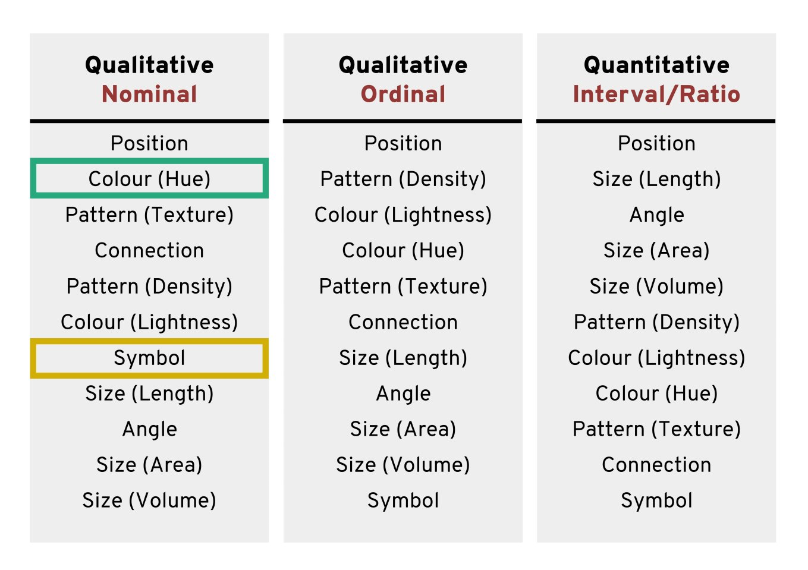
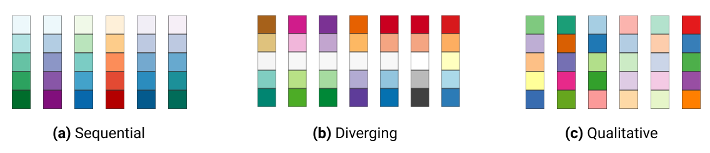
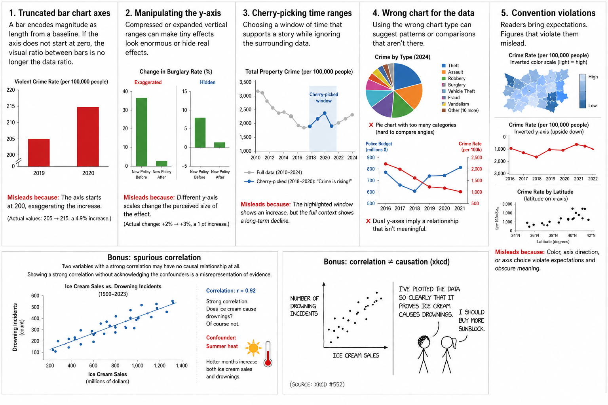
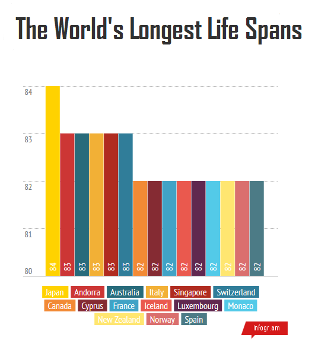
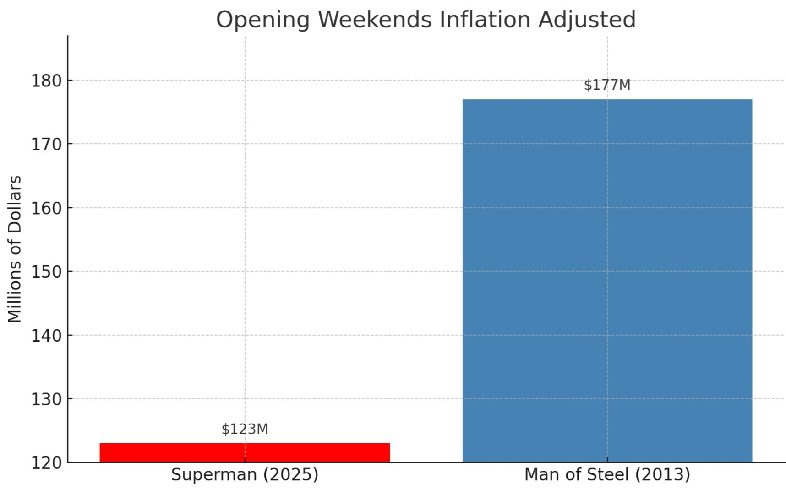
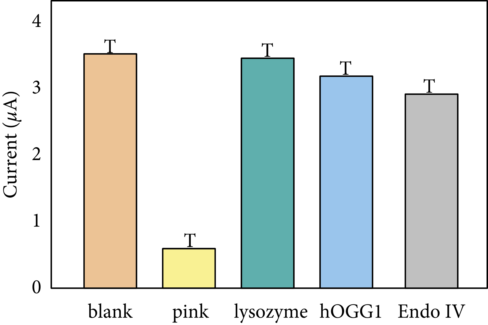

# Block 1: Foundations and graph crimes {.unnumbered}


```{r}
#| include: false
source("R/booktem_setup.R")
source("R/my_setup.R")
library(tidyverse)
library(here)
```


```{r}
# Run this code at the start of your project
library(palmerpenguins)
library(tidyverse)
library(ggdist)
library(ggrepel)
library(ggtext)
library(patchwork)
library(colorspace)
library(colorBlindness)
library(ggview)
library(ragg)
library(scales)
library(here)
library(ggiraph)   # interactive figures (Blocks 2 and 4)
library(ThemePark) # remotes::install_github("MatthewBJane/ThemePark") (Block 3)

# palmerpenguins::penguins is the package's ready-cleaned table
# (bill_length_mm, body_mass_g, ...). Drop incomplete cases for the figures
# used in worked examples
penguins_complete <- palmerpenguins::penguins |>
  tidyr::drop_na(body_mass_g, flipper_length_mm, bill_length_mm, bill_depth_mm, sex)
```

## We will cover:

- the *principles* of figure design (how to make a figure honest and informative, and accessible to every reader), 

- and the *extensions* of `ggplot2` that make those principles practical to implement.

The workshop runs in seven in-session blocks across three and a half hours including a break, with a take-home exercise to complete afterwards:

| Block | Duration | Focus |
|---|---|---|
| 1. Foundations and graph crimes | 50 min | Spot-it and estimate-the-value exercises, colour, data-ink, fixing a graph-crime scene |
| 2. Choosing the right figure | 35 min | Chart selection, audience, descriptive vs explanatory, interactive figures, designing for an audience |
| 3. Themes and scales | 35 min | `theme()`, `element_*()`, `theme_project()`, break-it-then-fix-it with ThemePark, `scales` package |
| Break | 15 min |  |
| 4. Extensions in action | 40 min | `ggdist`, `colorspace`, `ggrepel`, `ggtext`, `patchwork`, recreate-this-figure capstone |
| 5. Saving figures correctly | 10 min | `ggview`, `ragg`, two-format save, quick-save size test |
| 6. Writing figure legends | 20 min | The four-element legend, legend triage, legend repair |
| 7. Three questions for every figure | 5 min | Closing reflection |
| **Take-home exercise** | (own time) | Apply the workshop to your own data |

Before you arrive, please install the packages loaded in the setup chunk above. The take-home exercise is to be completed in your own time and reviewed at a follow-up session; you do not need to bring your own data to the workshop itself.

:::{.callout-note}
**How this works.** This is a doing session, not a watching one. Keep RStudio open alongside the session, and keep the course **Slack** channel open. Most exercises ask you to post an answer *before* you check it, and the longer ones have you build or fix a figure in your own RStudio and post a screenshot; we'll put a few on screen and talk through them. Everything works the same whether there are five of you or fifty. Wrong answers are useful: they show which principles are worth remembering.
:::

## How we see data

Our visual system did not evolve to read graphs. Some visual features are detected before conscious attention engages: a red dot among grey dots, a single triangle in a sea of circles, an unusually large shape in a field of small ones. This is called **pre-attentive processing** (Healey and Enns, 2012). If you encode important information as a feature the eye picks up automatically, readers see it without having to search. Encoding the same information as a subtle change in line style or a slightly different shade requires the reader to look for it.

## Exercise: spot it

We'll go through the tabs one at a time. Each plot hides one odd point among 80. Count the seconds it takes you to find it, and note them down; don't click ahead to the next tab. After the third tab, post your three times in Slack (for example `1, 3, 14`).

```{r}
#| include: false
set.seed(7)
spot <- tibble::tibble(x = runif(80), y = runif(80))
# a different odd point in each tab: the point nearest (tx, ty)
odd_near <- function(tx, ty) {
  seq_len(nrow(spot)) == which.min((spot$x - tx)^2 + (spot$y - ty)^2)
}
spot_colour <- dplyr::mutate(spot, odd = odd_near(0.85, 0.80))  # top right
spot_shape  <- dplyr::mutate(spot, odd = odd_near(0.15, 0.20))  # bottom left
spot_mixed  <- dplyr::mutate(spot, odd = odd_near(0.62, 0.50))  # centre right
spot_plot <- function(data, ...) {
  ggplot(data, aes(x, y, ...)) +
    geom_point(size = 4, show.legend = FALSE) +
    theme_void() +
    theme(plot.background = element_rect(fill = "white", colour = NA))
}
```

:::{.panel-tabset}

## Colour

```{r}
#| echo: false
#| fig-height: 3
spot_plot(spot_colour, colour = odd) + scale_colour_manual(values = c("grey60", "#D95F02"))
```

## Shape

```{r}
#| echo: false
#| fig-height: 3
spot_plot(spot_shape, shape = odd) + scale_shape_manual(values = c(16, 17))
```

## Colour *and* shape, mixed up

```{r}
#| echo: false
#| fig-height: 3
# grey points are circles, orange points are triangles;
# the odd one out is the only grey triangle
spot_mixed <- dplyr::mutate(spot_mixed,
                            col = ifelse(odd, "grey", sample(c("grey", "orange"), 80, TRUE)),
                            shp = ifelse(odd, "triangle", ifelse(col == "grey", "circle", "triangle")))
ggplot(spot_mixed, aes(x, y, colour = col, shape = shp)) +
  geom_point(size = 4, show.legend = FALSE) +
  scale_colour_manual(values = c(grey = "grey60", orange = "#D95F02")) +
  scale_shape_manual(values = c(circle = 16, triangle = 17)) +
  theme_void() +
  theme(plot.background = element_rect(fill = "white", colour = NA))
```

:::

Compare the times in Slack: the colour target is found almost instantly, the shape target a moment later. In the third tab the odd point is the only *grey triangle*, and no single feature gives it away, so everyone has to check points one by one. This is the cost of making readers combine features (a *conjunction search*).

## Exercise: estimate the value

Each round shows five values, and **A** is always the same. For each round, estimate **what percentage of A is B**, write it down, then check it in the box. Do one round at a time, without looking at the next tab. When you've done all four, post your four estimates in Slack and say which round was hardest.

```{r}
#| include: false
make_round <- function(ratio, seed) {
  set.seed(seed)
  v <- c(A = 80, B = 80 * ratio, C = runif(1, 30, 70),
         D = runif(1, 30, 70), E = runif(1, 30, 70))
  tibble::tibble(item = factor(names(v), levels = names(v)), value = v)
}
r1 <- make_round(0.62, 1); r2 <- make_round(0.38, 2)
r3 <- make_round(0.45, 3); r4 <- make_round(0.71, 4)
```

:::{.panel-tabset}

## Round 1

```{r}
#| echo: false
#| fig-height: 3
ggplot(r1, aes(item, value)) +
  geom_col(fill = "grey40", width = 0.6) +
  labs(x = NULL, y = NULL) +
  theme_minimal(base_size = 14) +
  theme(axis.text.y = element_blank(), panel.grid = element_blank())
```

B is what % of A? `r fitb(62, num = TRUE, tol = 5)` (within 5 points counts)

## Round 2

```{r}
#| echo: false
#| fig-height: 3.5
ggplot(r2, aes(x = "", y = value, fill = item)) +
  geom_col(width = 1, colour = "white") +
  geom_text(aes(label = item), position = position_stack(vjust = 0.5), size = 6) +
  coord_polar(theta = "y") +
  scale_fill_grey(start = 0.3, end = 0.85) +
  theme_void() +
  theme(legend.position = "none")
```

B is what % of A? `r fitb(38, num = TRUE, tol = 10)` (from here on, within 10 points counts)

## Round 3

```{r}
#| echo: false
#| fig-height: 3.5
r3 |>
  dplyr::mutate(x = c(1, 3, 5, 2, 4), y = c(1, 1, 1, 2, 2)) |>
  ggplot(aes(x, y, size = value)) +
  geom_point(colour = "grey40") +
  geom_text(aes(label = item), size = 5, colour = "white") +
  scale_size_area(max_size = 40) +
  xlim(0, 6) + ylim(0.3, 2.7) +
  theme_void() +
  theme(legend.position = "none")
```

B is what % of A? `r fitb(45, num = TRUE, tol = 10)`

## Round 4

```{r}
#| echo: false
#| fig-height: 3
# the key runs from 0 (white) to 100 (black), so there is a reference
ggplot(r4, aes(item, 1, fill = value)) +
  geom_tile(colour = "white", linewidth = 2) +
  geom_text(aes(y = 0.3, label = item), size = 6) +
  scale_fill_gradient(low = "white", high = "black", limits = c(0, 100),
                      breaks = c(0, 100), name = NULL) +
  theme_void(base_size = 14) +
  theme(legend.position = "bottom",
        legend.key.width = unit(4, "cm"))
```

B is what % of A? `r fitb(71, num = TRUE, tol = 10)` (use the key: white is 0, black is 100)

:::

`r hide("What just happened?")`

The answers were 62%, 38%, 45% and 71%. Look back at Slack: Round 1 guesses are usually tight, and they spread out with each round after that. In Round 3 most guesses are too high, because we underestimate differences in area: the small circle looks closer in size to the big one than it really is. In Round 4, even with a key, the shades are hard to place.

You have just played a version of Cleveland and McGill's (1984) experiment (they tested bars and pie slices; Rounds 3 and 4 go further). People read the same ratio most accurately as **position on a common scale**, then length, angle, area, and last shading and colour saturation. Mackinlay (1986) extended the ranking to categorical data: position is still best, but colour hue rises to second. Shape is weaker but useful as a redundant cue.

`r unhide()`

## The encoding hierarchy

```{r}
#| echo: false
#| eval: true

```

The practical rule is: assign your most important variable to the highest-ranked encoding available to you. For two continuous variables, both go to position (a scatter plot). For a continuous variable grouped by a category, position handles the continuous variable and colour hue handles the category, with shape added redundantly for accessibility.


:::{.panel-tabset}

## Colour

```{r}
#| eval: true
#| message: false
#| warning: false
penguins_complete |> 
  ggplot(aes(x = body_mass_g, y = flipper_length_mm,
             colour = species)) +
  geom_point(alpha = 0.7, size = 2.5) +
  colorspace::scale_colour_discrete_qualitative(palette = "Dark2") +
  labs(x = "Body mass (g)",
       y = "Flipper length (mm)",
       colour = "Species") +
  theme_minimal(base_size = 12) +
  theme(legend.position = "bottom")
```


## Shape

```{r}
#| eval: true
#| message: false
#| warning: false
penguins_complete |> 
  ggplot(aes(x = body_mass_g, y = flipper_length_mm,
            shape = species)) +
  geom_point(alpha = 0.7, size = 2.5) +
  labs(x = "Body mass (g)",
       y = "Flipper length (mm)",
       shape = "Species") +
  theme_minimal(base_size = 12) +
  theme(legend.position = "bottom")
```

## Both

```{r}
#| eval: true
#| message: false
#| warning: false
penguins_complete |> 
  ggplot(aes(x = body_mass_g, y = flipper_length_mm,
             colour = species, shape = species)) +
  geom_point(alpha = 0.7, size = 2.5) +
  colorspace::scale_colour_discrete_qualitative(palette = "Dark2") +
  labs(x = "Body mass (g)",
       y = "Flipper length (mm)",
       colour = "Species",
       shape = "Species") +
  theme_minimal(base_size = 12) +
  theme(legend.position = "bottom")
```

:::

Two continuous variables to position (rank 1), one categorical to colour hue (rank 2 for categorical data), with shape added as a redundant cue. The figure works on a colour monitor, in greyscale print, and for a reader with colour vision deficiency. Treat this as the minimum for every figure.

## Colour as a tool

Colour hue is the second-most powerful encoding for categorical data, and it is pre-attentive, so readers pick it up without searching. It is also the encoding most often misused. Three palette types exist, each for a different data structure:

| Palette type | Data structure | Example use |
|---|---|---|
| Qualitative | Discrete groups with no inherent order | Species, treatment arm |
| Sequential | Continuous, running in one direction from a minimum | Gene expression, density |
| Diverging | Continuous, with a meaningful midpoint | Log fold-change, temperature anomaly |

```{r}
#| echo: false
#| eval: true

```

Using the wrong type for the data structure is one of the most common errors. A sequential palette applied to categorical data implies an ordering that does not exist. A categorical palette applied to a continuous variable conceals the ordering that does exist.

The package `colorspace` (Zeileis et al., 2020) provides palette generators for all three types with documented design rationale, and is the project default for palette construction. The Dark2 palette ships directly:

```{r}
#| eval: true
#| fig-height: 3
#| fig-width: 8
# Categorical (Dark2): for discrete groups with no order
colorspace::swatchplot(
  colorspace::qualitative_hcl(8, palette = "Dark2")
)
```

The same package provides `scale_*_discrete_qualitative()`, `scale_*_continuous_sequential()`, and `scale_*_continuous_diverging()` functions that integrate directly with `ggplot2`. Prefer these over manual hex vectors.

**Quick check: which palette type?**

- Treatment arm (control, drug A, drug B): `r mcq(c(answer = "Qualitative", "Sequential", "Diverging"))`
- Change in body mass after a season, where 0 = no change: `r mcq(c("Qualitative", "Sequential", answer = "Diverging"))`
- Number of eggs per nest: `r mcq(c("Qualitative", answer = "Sequential", "Diverging"))`

## Accessibility

Roughly 8% of men have some form of colour vision deficiency (Sharpe et al., 1999); red-green is by far the most common. Using red and green to distinguish two groups will fail for a non-trivial fraction of any audience. The Okabe-Ito palette was designed to remain distinguishable under deuteranopia and protanopia (Okabe and Ito, 2008), and the viridis palette family is perceptually uniform under colour vision deficiency and in greyscale.

Beyond palette choice, the main rule is **redundant encoding**: never let colour be the only cue distinguishing groups. Use shape redundantly for points, linetype redundantly for lines, and direct labelling wherever it is legible (we will cover direct labelling in Block 4).

The `colorBlindness` package gives you the verification step. `colorBlindness::cvdPlot()` produces, by default, a four-panel simulation: the original ("normal vision"), deuteranopia, protanopia, and a desaturated (greyscale) version. This lets you see whether the figure still works when colour fails. Extra "enhanced" panels can be requested through its `layout` argument; note that it does not simulate tritanopia.

```{r}
#| eval: false
fig <- penguins_complete |> 
  ggplot(aes(x = body_mass_g, y = flipper_length_mm, colour = species)) +
  geom_point(alpha = 0.7) +
  colorspace::scale_colour_discrete_qualitative(palette = "Dark2") +
  theme_minimal()

colorBlindness::cvdPlot(fig)
```

:::{.callout-tip}
After the workshop, run `cvdPlot()` on three or four figures from your own thesis chapter or recent paper. Be honest about which ones fail.
:::

## Data-ink ratio

Tufte (1983) introduced **data-ink ratio**: the proportion of a figure's visual elements that actually encode data, as opposed to decoration, borders, gridlines, shadows, and three-dimensional effects that exist for their own sake. High data-ink ratio means most of the visual complexity of the figure carries information.

The default `ggplot2` `theme_grey()` already fails this test: a grey panel background and white gridlines exist purely as decoration. Move to `theme_minimal()`, `theme_classic()`, or a project-specific theme function as your default.

:::{.callout-warning}
Avoid `theme_grey()` (the `ggplot2` default) in any figure intended for human consumption. Set `theme_minimal(base_size = 12)` or `theme_classic(base_size = 12)` as your project baseline.
:::

## Graph crimes

A figure that violates these principles distorts what the data actually say. Five recurring crimes are worth recognising on sight:

```{r}
#| echo: false
#| eval: true

```

1. **Truncated bar chart axes.** A bar encodes magnitude as length from a baseline. If the axis does not start at zero, the visual ratio between bars is no longer the data ratio.
2. **Manipulating the y-axis.** Compressed or expanded vertical ranges can make tiny effects look enormous or hide real effects.
3. **Cherry-picking time ranges.** Choosing a window of time that supports a story while ignoring the surrounding data.
4. **Wrong chart for the data.** Pie charts for many categories; line charts for unordered categorical data; dual y-axes pretending two arbitrary scales are commensurable.
5. **Convention violations.** Inverted colour scales (light = high); inverted y-axes; latitude on the x-axis. Readers bring expectations, and figures that violate them mislead.

A bonus crime: spurious correlation. Two variables with a strong correlation may have no causal relationship at all. Showing a strong correlation without acknowledging the confounders is a misrepresentation of evidence.

### Warm-up: graph crimes

:::{.task}
::::{.task-header}
Exercise: name the crime (3 minutes)
::::
::::{.task-container}

For each figure below, write one line in the form **problem → fix** (e.g. *"truncated axis → start at zero"*), and say whether the problem is one of *distortion* (the visual misrepresents the data) or *omission* (the figure leaves out something the reader needs). Post your lines in Slack, then compare them with the verdicts below.

::::
:::


:::{.panel-tabset}

## Example 1

```{r}
#| echo: false

```

## Example 2

```{r}
#| echo: false

```

## Example 3

```{r}
#| echo: false
#| fig-height: 4
palmerpenguins::penguins |>
  dplyr::filter(!is.na(body_mass_g)) |>
  dplyr::summarise(mass = mean(body_mass_g), .by = c(species, island)) |>
  dplyr::mutate(group = paste(species, island, sep = " – ")) |>
  ggplot(aes(x = "", y = mass, fill = group)) +
  geom_col(width = 1, colour = "white") +
  coord_polar(theta = "y") +
  labs(title = "Penguin body mass", fill = NULL) +
  theme_void(base_size = 13)
```

:::


**Bonus.** Look closely at the error bars.

```{r}
#| echo: false

```

`r hide("The verdicts")`

- **Example 1: guilty of distortion.** The y-axis starts at 80, so Japan's 84 looks twice the height of Spain's 82 when the real difference is under 3%. The 15-colour legend adds nothing the axis labels could not. *Sentence:* start the axis at zero, or show points on a sensible range, and drop the legend.
- **Example 2: guilty of distortion.** The axis starts at 120, so a \$123M opening looks almost nothing next to \$177M. *Sentence:* bars from zero, or a dot plot with labelled values.
- **Example 3: guilty of distortion and omission.** A pie chart says its slices are parts of one whole, but these are *average* body masses: adding them up means nothing. Angles are hard to compare, so the four slices between 3,688 g and 3,733 g look identical, and Gentoo (5,076 g, about 37% heavier) looks only a little bigger. There are no values, units, sample sizes or spread, and the default colours are not safe for colour-blind readers. *Sentence:* a dot plot of each group's mean with the raw data behind it, sorted, with axis units.
- **Bonus: guilty of everything.** The "error bars" are the capital letter **T** typed above each bar. They show no variability at all, on top of a dynamite plot that hides the raw data. *Sentence:* plot the raw points with a real interval.

`r unhide()`

### Exercise: fix a graph-crime scene

:::{.task}
::::{.task-header}
Fix the crime scene (12 minutes)
::::
::::{.task-container}

The code below was found at a crime scene. It uses `chickwts`, a dataset built into R: the weight of chicks after six weeks on one of six feed supplements. Copy it into RStudio and run it. There are **at least eight** graph crimes in it.

1. **Investigate (4 min).** List every crime you can find, then post your list in Slack.
2. **Rehabilitate (8 min).** Rewrite the code into an honest, accessible figure in your own RStudio.
3. **Check.** Post a screenshot of your fixed figure in Slack, then go through the case file below: which crimes did you spot, which did you fix, and which did you miss? We'll put a few fixed figures on screen and talk through the choices.

```{r}
#| eval: false
chickwts |>
  group_by(feed) |>
  summarise(mean_weight = mean(weight), se = sd(weight) / sqrt(n())) |>
  ggplot(aes(x = feed, y = mean_weight, fill = feed)) +
  geom_col() +
  geom_errorbar(aes(ymin = mean_weight - se, ymax = mean_weight + se), width = 0.2) +
  coord_cartesian(ylim = c(150, 350)) +
  scale_fill_manual(values = rainbow(6)) +
  labs(x = "feed", y = "mean_weight") +
  theme_grey()
```

::::
:::

`r hide("Case file: the crimes and a rehabilitated figure")`

1. **Dynamite plot.** Bars of means hide the 71 individual chicks.
2. **Truncated axis.** The bars start at 150 g, so horsebean looks a fraction of casein's weight; the real ratio is about half.
3. **Undefined error bars.** They are ± 1 SE, but nothing says so.
4. **Rainbow palette.** Not colour-blind safe (red vs green), and the lightness jumps around.
5. **Redundant legend.** Colour repeats the x-axis, so the legend is pure eye-travel.
6. **Unordered categories.** Alphabetical order hides the ranking.
7. **Variable names as labels.** "mean_weight" with no units.
8. **`theme_grey()`.** The grey panel fails the data-ink test.

```{r}
#| fig-height: 4
chickwts |>
  mutate(feed = fct_reorder(feed, weight, .fun = median)) |>
  ggplot(aes(x = weight, y = feed)) +
  geom_jitter(height = 0.15, alpha = 0.6, colour = "grey45") +
  stat_summary(fun = median, geom = "point", shape = 23,
               size = 3.5, fill = "#D95F02") +
  labs(x = "Chick weight at six weeks (g)", y = "Feed supplement",
       caption = "Points: individual chicks. Diamonds: medians.") +
  theme_minimal(base_size = 12) +
  theme(panel.grid.minor = element_blank())
```

Every chick is visible, the feeds are ranked, there is one colour with a job (the median), the axis has units, and no legend is needed. Because these are points rather than bars, the axis does not need to start at zero.

`r unhide()`
