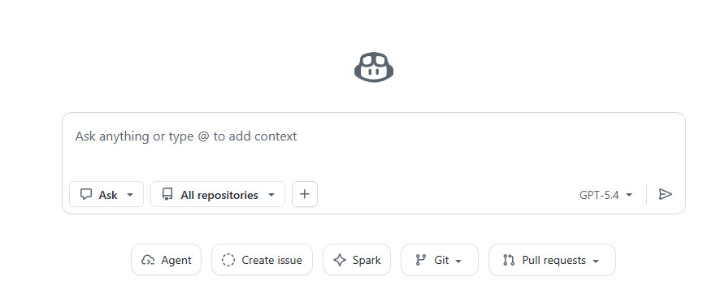
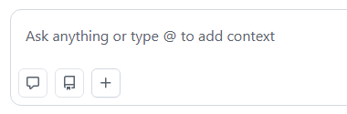

# Block 4: GitHub Copilot Chat in Ask mode {.unnumbered}


```{r}
#| include: false
source("R/booktem_setup.R")
source("R/my_setup.R")
library(tidyverse)
library(here)
library(webexercises)
```

GitHub Copilot Chat comes with the same Copilot plan as inline completion, but it gives a different kind of help, and it does not necessarily use the same model: the chat model and the inline-completion model are configured separately. Inline completion is best when you are actively writing code and want quick suggestions or continuations. Chat is better for higher-level tasks such as planning an approach, understanding an error, or discussing design decisions. Chat requests need more computation, so they are the part of Copilot most likely to run into your plan's usage limits (at the time of writing, October 2026, a monthly allowance of GitHub AI Credits). The two tools complement each other rather than replace one another.

*⏱ ~30 minutes*


## What Chat sees, and what it does not

Here GitHub Copilot Chat differs from a general chatbot such as ChatGPT, and the difference is easy to get wrong. A general chatbot sees what you paste or upload, plus whatever you have connected it to through its own connectors; it has no built-in link to your editor or your R session. GitHub Copilot is integrated with your repository and editor and can draw on context you did not paste. How much it draws on, and whether it can act on your machine, depends on where you use it. Three surfaces matter for this workshop, and they are not equivalent.

- **Browser Chat on github.com**: open your repository on github.com and select the Copilot icon. It works in the context of that repository and can reach its files, but it has no connection to your local machine, runs no code, and cannot see your R session. This is the one that behaves the same for everyone.

- **VS Code Chat panel**: Copilot Chat is built into VS Code. It can see your open files, and you can add context explicitly: type `#` in the chat box to reference a file or `#codebase` for the whole workspace, or use the **Add Context** button. It does not see the objects in your R session unless you paste them, or unless an agent runs code for you.

- **Positron Chat panel**: Positron's built-in chat is now **Posit Assistant**, which replaced the deprecated Positron Assistant and is the default AI experience from Positron 2026.07. It is not Copilot Chat: it runs on a model provider you choose, either Posit's own subscription or a bring-your-own provider such as GitHub Copilot (in preview). The difference that matters is the context it adds. Posit Assistant is given context about your interactive data science work, such as your loaded data, plots, **and console history**, and it can run code. So in Positron the "cannot see your data" assumption does not hold the way it does in browser Chat. See the [Posit Assistant documentation](https://positron.posit.co/assistant.html).

Separately from the surface, your repository's `.github/copilot-instructions.md`, if present, is added automatically to Copilot Chat requests in that repository or workspace (*see Block 6*). Exactly what else is pulled in automatically has changed between versions and differs across surfaces, so the reliable habit is to set the context yourself (by pasting, attaching, or `#`-referencing) rather than to assume.


Run these exercises in **Ask mode**: browser Chat for everyone (open your repository on [github.com](https://github.com) and select the Copilot icon), or the in-IDE chat in VS Code or Positron.

```{r}
#| echo: false
#| eval: true

```

:::{.callout-note}
An assistant can describe your data confidently for two different reasons: (1) it has been given real information about your session, or (2) it is recalling something from training data. Only the first is reliable.

It has real information when one of these holds: you pasted the output (`glimpse()`, `summary()`, the printed result), or the data sits in a file it can read.

In Positron, Posit Assistant is given your session context, and it can run code and read the output.

It is guessing from training data when none of those apply, which is the case in browser Chat on github.com unless the data file is in the repository or you have pasted its structure. Tells: it substitutes a well-known dataset (mtcars, iris, penguins) you never mentioned, or asserts column names, factor levels, or values you never supplied.

Even when context is supplied, the model's claim about what it can see is unreliable, and the context may be structure rather than actual values. Verify any data-specific claim against your real object.

:::


**Browser Chat** (all IDEs, including RStudio): navigate to your repository on [github.com](https://github.com) and click the Copilot icon in the top right. This is the one that works for everyone.

**In-IDE Chat panel** (VS Code and Positron): open the chat view, and use `#` references or **Add Context** to control what it sees. Both also offer slash commands: type `/` in the chat box to see the list for your editor. In VS Code these include `/explain` to describe what code does and `/fix` to propose a correction, which act on the code you have selected. Posit Assistant in Positron has its own set, such as `/plan` to draft a plan before changing code and `/new` to start a fresh conversation.

RStudio users should use the browser Chat throughout this block. RStudio's own Posit Assistant chat is not part of your Copilot plan, so we do not use it here. Positron and VS Code users may use either browser or in-IDE chat; the exercises work in both, subject to the context caveat above.


## Exercise 1: Reading a stack trace

:::{.task}
::::{.task-header}
Exercise 1: Reading a stack trace
::::
::::{.task-container}

This exercise shows how much the quality of Chat's answers depends on the context you supply.

**If you use in-IDE chat in Positron, start from a session without `voles` loaded (or use browser Chat), so that the session context does not hand over the answer.**

**1. Open a fresh Chat session. Paste only the following error message and ask "What does this error mean?":**

```
Error in `mutate()`:
ℹ In argument: `mass_change = mass_post - mass_pre_g`.
Caused by error:
! object 'mass_post' not found
```

Read the answer. It will be reasoning from the error alone.

*Try* changing the model in the model picker below the prompt box, if your plan allows it, and compare the answers. (At the time of writing, Copilot Free and Copilot Student offer only Auto, where Copilot chooses the model for you.)

**2. Now open a new Chat session and paste the same error along with the code that produced it and the output of `glimpse(voles)`:**

```
I am running this code:

  voles |>
    mutate(mass_change = mass_post - mass_pre_g)

and getting:

  Error in `mutate()`:
  ℹ In argument: `mass_change = mass_post - mass_pre_g`.
  Caused by error:
  ! object 'mass_post' not found

The data structure is:

  Rows: 72
  Columns: 6
  $ subject_id          <chr> "V001", "V002", "V003", ...
  $ sex                 <chr> "M", "F", "M", ...
  $ treatment_arm       <chr> "Control", "Control", ...
  $ mass_pre_g          <dbl> 28.3, 27.9, 30.1, ...
  $ mass_post_g         <dbl> 28.5, 28.0, 30.5, ...
  $ metabolic_rate_post <dbl> 13.21, 12.84, 13.55, ...

What is wrong?
```

Read this answer. It will name the specific bug (a missing `_g` suffix on `mass_post`) and propose the fix.


**3. Now open a new Chat session, attach the file from the repository, and try pasting the error message:**

```{r}
#| echo: false
#| eval: true

```

With the file itself in context, Copilot can see the column names directly, so it should again identify the missing `_g` suffix, this time without your having pasted `glimpse()` output. No one route is the correct one. The answer is only as good as the context, and context reaches the model by more than one route: what you paste, and what the surface can already read.

Compare the three answers. The first reasons from the error text alone and can only guess. The second and third both locate the specific bug, because both were given the column names, one by your paste and one by reading the file.

::::
:::


## How much of your data to show

The contents of your data can reach the model by three routes, and each is a disclosure:

- You paste it into the chat: an error, an output, a printed result.

- It reads a data file that sits in a repository or workspace it can see. Browser Chat on github.com works in the context of the repository you open it from, so a committed `voles_metabolism.csv` is within reach; in VS Code, Copilot can search your workspace when you use `#codebase`.

- The IDE injects your session context. In Positron, Posit Assistant is given context about your interactive data science work, such as your loaded data, plots, and console history, so a data frame already in memory can reach it without a paste.

Describing your data to Chat is a recurring task, but pasting is not the only way your data is exposed. Before you decide what to show, know what the surface can already reach: a data file committed to the repo, or a tibble loaded in a Positron session, may have been disclosed already.

When you do describe a data frame deliberately, three commands reveal increasing amounts:

- `names(voles)`, or equivalently `colnames(voles)`, lists the column names only, in their original order, and discloses nothing about the values. Prefer this to `ls(voles)`, which returns the same names but sorts them alphabetically and so loses the column order.

- `summary(voles)` adds the range, quartiles, and missing-value counts for numeric columns, and is less informative for character or factor columns. It reveals the shape of the data, not individual records.

- `glimpse(voles)` and `str(voles)` add the first few actual values of every column.


## Exercise 2: Refining an approach question

:::{.task}
::::{.task-header}
Exercise 2: Refining an approach question
::::
::::{.task-container}

Run this in browser Chat, or with no analysis file referenced. If your script is open in the editor, Copilot may infer the design from it, and the first answer will be less generic than described below. The refinement in step 2 still helps in that case, because your scientific question and your design intent are not written in any file; they exist only in your head until you state them.

**1. Open a Chat session and ask, exactly as written:**

```
I have a dataset with pre and post measurements. How should I analyse it?
```

Read the answer. With no design and no scientific question supplied, it will be a tour of paired t-tests, mixed models, change scores, ANCOVA, and so on, because the question is too vague to permit a recommendation.

**2. In a new chat session, refine the question, with the dataset structure and the scientific question explicit:**

```
I have 72 voles, balanced across three treatment arms (Control, Low_dose,
High_dose) and two sexes (M, F). Each animal has body mass measured before
and after treatment, and a single post-treatment metabolic-rate reading.

My biological question is whether the high-dose treatment changes mass
relative to control, and whether the effect differs between sexes.

The dataset is small (n = 12 per cell). I will report effect sizes
alongside any inferential test. Given this design, what is a defensible
primary analysis, and what are the main threats to its validity?
```

**3. In a new chat session, add the raw data file as context.**

Try asking the first, vague question again:

```
I have a dataset with pre and post measurements. How should I analyse it?
```

Compare all three answers. Which was best?

Even though the question is the same vague one from step 1, the file in context supplies the design that the prompt omits: column names, types, and the treatment arms. The answer should narrow accordingly, closer to step 2 than to step 1, without your having stated the design in prose.

::::
:::


## When to use Chat versus inline

A short decision rule covers most cases:

| Task | Inline | Chat |
|---|---|---|
| Writing the next line of code | Yes | No |
| One-line typo or syntax fix | Yes | No |
| Reading an unfamiliar error | Marginal | Yes |
| Choosing between two approaches | No | Yes |
| Planning the structure of a script | No | Yes |
| Refactoring more than a few lines | No | Yes |

The rule is not strict; the two tools overlap considerably. The principle is: inline for typing, Chat for thinking.


## Check your understanding

**Which statement best describes the context available to Copilot Chat in Ask mode, in the browser on github.com or in your IDE?**

`r longmcq(c(
  "It sees only the text you paste into the prompt, nothing else",
  answer = "Beyond what you paste, it can draw on the repository or project it is opened from and on files you attach or reference; what else it sees (open files, your R session) depends on the surface",
  "It has full automatic access to every file in the repository and to your running R session, on every surface",
  "It can always execute your R code to read the data directly"
))`

