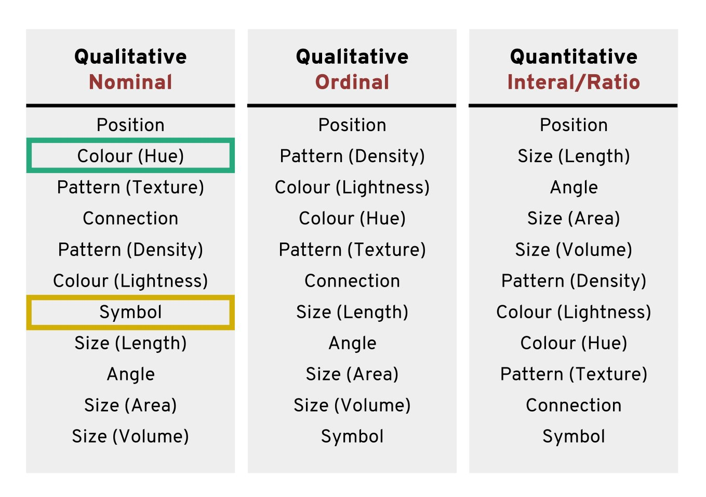
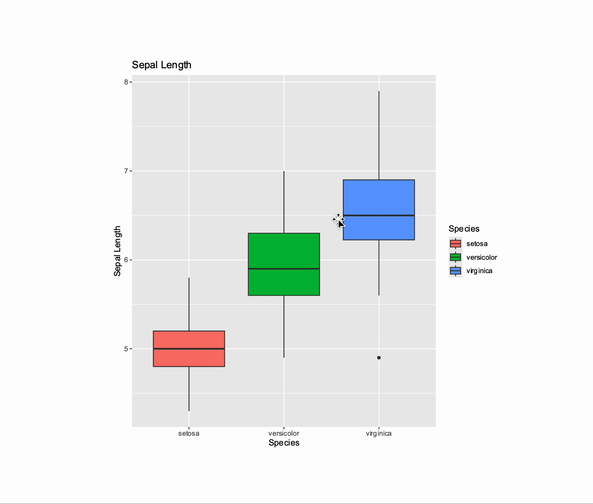

# ggplot2 {#sec-ggplot2}

```{r}
#| include: false
source("R/booktem_setup.R")
source("R/my_setup.R")
library(tidyverse)
library(here)

penguins <- readRDS(here("files", "chapter5.RDS"))
```


## Learning Objectives

By the end of this chapter, you will be able to:

- Prepare and summarise data for advanced plotting.

- Control aesthetics and grouping behaviour in multilayered plots.

- Use and combine a broad range of geoms, including line and label.

- Customise and extend colours, palettes, scales, axes, and legends.

- Use facets effectively for multi-dimensional comparisons.

- Arrange and enhance plots using patchwork and marginal plots.

- Export visualisations with `ggsave()` and make them interactive with plotly.

:::{.callout-note}
Like @sec-ggplot, this appendix uses the `penguins` data from `files/chapter5.RDS`, which keeps the original `culmen_length_mm` and `culmen_depth_mm` column names (called `bill_length_mm` and `bill_depth_mm` in `palmerpenguins::penguins` and on Day 3).
:::


## Colours, palettes and extensions

Colour is one of the strongest visual cues in data visualisation.
In `ggplot2`, colours can mark categories, highlight relationships and guide the viewer’s attention.
It is also one of the most common sources of confusion and inaccessibility.

### How colour works in `ggplot2`

`ggplot2` applies colour in two main ways:

- Mapped colour: controlled by a variable in `aes()`, such as `colour = species` or `fill = species`.

- Fixed colour: set manually outside `aes()`, e.g. `geom_point(colour = "blue")`.

```{r}
penguins |> 
  ggplot(aes(x=flipper_length_mm, 
             y = body_mass_g,
             colour=species))+ 
  geom_point()

```

:::{.task}
::::{.task-header}
Your turn
::::
::::{.task-container}

* [ ] Change the code above so that all the points are coloured blue.

`r hide("Solution")`

```{r}

penguins |> 
  ggplot(aes(x=flipper_length_mm, 
             y = body_mass_g))+ 
  geom_point(colour = "blue")

```

> The colour argument needs to go *inside* the relevant `geom()`, as only `aes` is inherited across layers.


`r unhide()`

::::
:::


## Choosing Effective Palettes

:::{.callout-tip}
Choosing palettes and checking them for colour vision deficiency are covered in more depth in Day 3, Block 1 (Colour and Accessibility) and Block 4 (Accessible colour with colorspace and colorBlindness).
:::

Good palettes show contrast and group differences, and stay readable for all audiences.

In `ggplot2`, colours that are assigned to variables are modified via the `scale_colour_*` and the `scale_fill_*` functions. To use colour with your data, the most important thing to know is whether you are dealing with a categorical or continuous variable. Choose the colour palette according to the type of variable:

- sequential or diverging colour palettes for continuous variables

- qualitative colour palettes for (unordered) categorical variables

```{r}
#| eval: true
#| echo: false
#| out-width: "100%"
#| fig-alt: "Colour palettes"
knitr::include_graphics("images/palette.png")
```

You can pick your own sets of colours and assign them to a categorical variable. The number of specified colours has to match the number of categories. You can use a wide range of preset [colour](https://www.datanovia.com/en/blog/awesome-list-of-657-r-color-names/) names or you can use [hexadecimals](https://www.datanovia.com/en/blog/awesome-list-of-hexadecimal-colors-you-should-have/).

```{r}

ggplot(penguins, aes(x = body_mass_g, fill = species)) +
geom_histogram(bins = 20, 
               alpha = 0.7, 
               position = "identity") +
scale_fill_manual(values = c("Adelie" = "#1b9e77", 
                             "Chinstrap" = "#d95f02", 
                             "Gentoo" = "#7570b3")) +
theme_minimal()
```

### Using Predefined Palettes from colorspace

The `colorspace` @R-colorspace package offers curated, perceptually balanced palettes designed for clarity and accessibility.

You can select qualitative, sequential, or diverging palettes using `scale_*_discrete_qualitative(palette = "*")` or similar functions.

```{r}
library(colorspace)

ggplot(penguins, aes(x = body_mass_g, fill = species)) +
geom_histogram(bins = 20, alpha = 0.7, position = "identity") +
scale_fill_discrete_qualitative() +
theme_minimal()

```

:::{.task}
::::{.task-header}
Your turn
::::
::::{.task-container}

Explore the palettes available in `colorspace`:

* [ ] Run the command `hcl_palettes(plot = TRUE)`

* [ ] Choose an appropriate palette and try it for our plot


`r hide("Solution")`

```{r}
library(colorspace)

ggplot(penguins, aes(x = body_mass_g, fill = species)) +
geom_histogram(bins = 20, alpha = 0.7, position = "identity") +
scale_fill_discrete_qualitative(palette = "Dark2") +
theme_minimal()
```

`r unhide()`

::::
:::


### Other palettes

- [Generate a palette](https://mycolor.space/)

- [Wes Anderson palettes](https://github.com/karthik/wesanderson)

- [ggokabeito](https://malcolmbarrett.github.io/ggokabeito/)

- [scico](https://github.com/thomasp85/scico)


### Accessibility

It’s very easy to get carried away with colour palettes, but your figures must always be accessible. One way to check how accessible your figures are is to use a colour blindness checker, `colorBlindness` @R-colorBlindness.

```{r}
## Check accessibility ----

library(colorBlindness)
colorBlindness::cvdPlot() # will automatically run on the last plot you made
```

### Guides to visual accessibility

Using colours to tell categories apart can be useful, but as we can see in the example above, you should choose carefully. Other aesthetics you can use in your geoms include shape and size, and you can combine these with colour to make your plots more accessible. Here is a hierarchy of “interpretability” for different types of data:

```{r}
#| eval: true
#| echo: false
#| out-width: "100%"
#| fig-alt: "Hierarchy of how accurately different aesthetics can be interpreted"

```

:::{.panel-tabset}

## Shape

```{r}
penguins |> 
  ggplot(aes(x=flipper_length_mm, 
             y = body_mass_g,
             shape=species))+ 
  geom_point() +
  scale_shape_manual(values = c(21,22,23))

```

## Colour

```{r}
penguins |> 
  ggplot(aes(x=flipper_length_mm, 
             y = body_mass_g,
             colour=species))+ 
  geom_point() +
  scale_colour_manual(values = c("Adelie" = "#1b9e77", 
                             "Chinstrap" = "#d95f02", 
                             "Gentoo" = "#7570b3")) 
```

## Colour redundancy

```{r}
penguins |> 
  ggplot(aes(x=flipper_length_mm, 
             y = body_mass_g,
             colour=species,
             shape = species))+ 
  geom_point() +
  scale_colour_manual(values = c("Adelie" = "#1b9e77", 
                             "Chinstrap" = "#d95f02", 
                             "Gentoo" = "#7570b3")) 

```

:::

## Grouping logic

When drawing lines with `geom_line()`, ggplot2 needs to know which points belong together.

If it cannot infer groups, it will connect every point in order of x, producing meaningless zigzags.

Let’s see how grouping works implicitly, explicitly and in summary form.

```{r}
ggplot(penguins, aes(x = culmen_length_mm, y = flipper_length_mm)) +
    geom_line()

```

### Implicit grouping via colour or fill

Discrete aesthetics such as `color`, `fill`, or `linetype` automatically define groups.

```{r}
ggplot(penguins, aes(x = culmen_length_mm, y = flipper_length_mm,
color = species)) +
  geom_line()


```

### Explicit grouping

Explicit grouping defines the groups by which lines should be drawn (still in order of x) without relying on other aesthetics or implicit grouping.

```{r}

ggplot(penguins, aes(x = culmen_length_mm, y = flipper_length_mm,
group = species)) +
  geom_line()


```

```{r}
ggplot(penguins, aes(x = culmen_length_mm, y = flipper_length_mm,
colour = species, group = individual_id)) +
  geom_line()

```

### Summary trend lines

```{r}

ggplot(penguins, aes(x = culmen_length_mm, y = flipper_length_mm,
colour = species)) +
  geom_point(alpha =.8)+
  geom_smooth(method = "lm")


```

## Scales, Axes and Ordering

### Axes limits

Now, we'll use `scale_x_continuous()` and `scale_y_continuous()` for setting our desired values on the axes. 

The key parameters in both functions are:

- "limits" (defined as `limits = c(value, value)`) 

- "breaks" (which represent the tick marks, specified as `breaks = value:value`). 

Note that "limits" are only two values (the minimum and maximum), while "breaks" are a range of values (for instance, from 0 to 100).

```{r}
## Set axis limits ----
penguins |> 
  ggplot(aes(x=flipper_length_mm, 
             y = body_mass_g,
             colour=species))+ 
  geom_point()+
  geom_smooth(method="lm",    
              se=FALSE)+
  scale_colour_manual(values = c("Adelie" = "#1b9e77", 
                             "Chinstrap" = "#d95f02", 
                             "Gentoo" = "#7570b3")) +
  scale_x_continuous(limits = c(0,240), 
                     breaks = seq(20,240,by = 20))+
  scale_y_continuous(limits = c(0,7000), 
                     breaks = seq(0,7000,by = 10))
 

```

:::{.task}
::::{.task-header}
Your turn
::::
::::{.task-container}

Pick a more appropriate set of axis breaks:


`r hide("Solution")`
R chooses the limits and breaks for you automatically. But it is useful to know how to override this when needed.

```{r}
## Set axis limits ----
penguins |> 
  ggplot(aes(x=flipper_length_mm, 
             y = body_mass_g,
             colour=species))+ 
  geom_point()+
  geom_smooth(method="lm",    
              se=FALSE)+
  scale_colour_manual(values = c("Adelie" = "#1b9e77", 
                             "Chinstrap" = "#d95f02", 
                             "Gentoo" = "#7570b3")) +
  scale_x_continuous(limits = c(160,240), 
                     breaks = seq(160,240,by = 20))+
  scale_y_continuous(limits = c(2500,6500), 
                     breaks = seq(2500,6500,by = 500))

```

`r unhide()`

::::
:::


### Zooming in and out

We have seen how we can set the parameters for the axes for both continuous and discrete scales.

It can be useful to zoom in and out of figures, mainly to focus on one section of the plot.

One function we can use to do this is `coord_cartesian()` in ggplot2, where you can:

- Set the limits on the x-axis `(xlim = c(value, value))`

- Set the limits on the y-axis `(ylim = c(value, value))`

- Set whether to add a small expansion to those limits or not `(expand = TRUE/FALSE)`.

```{r}
penguins |> 
  ggplot(aes(x=flipper_length_mm, 
             y = body_mass_g,
             colour=species))+ 
  geom_point()+
  geom_smooth(method="lm",    
              se=FALSE)+
  scale_colour_manual(values = c("Adelie" = "#1b9e77", 
                             "Chinstrap" = "#d95f02", 
                             "Gentoo" = "#7570b3")) +
  coord_cartesian(xlim = c(180,210), 
                  ylim = c(3000,4000), 
                  expand = FALSE)
  
```

:::{.callout-important collapse="true"}
## Limits vs co-ords

This IS different to setting the axis limits. `coord_cartesian` is like a *zoom*, while `scale` sets the plotting range. 

Below we use a shortcut to scale with `xlim` and `ylim` - the trendline is now calculated only from the visible/plotted points.

```{r}
penguins |> 
  ggplot(aes(x=flipper_length_mm, 
             y = body_mass_g,
             colour=species))+ 
  geom_point()+
  geom_smooth(method="lm",    
              se=FALSE)+
  scale_colour_manual(values = c("Adelie" = "#1b9e77", 
                             "Chinstrap" = "#d95f02", 
                             "Gentoo" = "#7570b3")) +
  xlim(180,210) +
  ylim(3000,4000)
```
:::


### Axis ordering

Axis ordering affects how quickly and accurately viewers can interpret data.

For example, ordering categories by value shows which groups have the highest or lowest measurements, while random or inconsistent ordering makes comparisons confusing.

By default R will order categories along the axis in alphabetical order: 

```{r}
penguins |> 
ggplot(aes(x = species)) +
  geom_bar()

```
::: {.callout-note icon="false"} 

## Question

What makes the default ordering less than suitable for rapid comparisons? 

:::

#### Reordering manually

To switch the order, use the `scale_x_discrete()` function and set the limits within it (limits = c("category","category")):

```{r}
penguins |> 
  ggplot(aes(x = species)) +
  geom_bar()+
  scale_x_discrete(limits = c("Adelie", "Gentoo","Chinstrap")) 
```


#### Reordering by values

Or by using features in the `forcats` package:

- `fct_infreq()`: orders by frequency

- `fct_reorder()`: orders by another numeric variable (e.g., mean body mass)

```{r}
penguins |> 
  mutate(species = forcats::fct_infreq(species)) |> 
  ggplot(aes(x = species)) +
  geom_bar()
```

:::{.task}
::::{.task-header}
Your turn
::::
::::{.task-container}

How could we improve the readability of this plot even further?

`r hide("Solution")`
```{r}
penguins |> 
  mutate(species = forcats::fct_infreq(species)) |> 
  # Species on the y axis gives horizontal bars, which are easier to read
  ggplot(aes(y = species)) +
  geom_bar()+
  # Direct annotation
  geom_label(stat='count', aes(label=after_stat(count)))+
  # reverse order so the most common species is at the top
  scale_y_discrete(limits = rev)+
  # Redundant titles removed
  labs(y = "",
       x = "Count")
```
`r unhide()`

::::
:::

## Facets

When it becomes difficult to see the trends or differences in your plot, we can break up a single plot into sub-plots; this is called ‘faceting’. Facets are commonly used when there is too much data to display clearly in a single plot.

### Cluttered plots

In the example below it is hard to see the exact distribution of each histogram:

```{r}
penguins |> 
  ggplot(aes(body_mass_g,
             fill = species))+
  geom_histogram()+
  scale_fill_manual(values = c("darkorange", "purple", "cyan"))

```
Facetted panels make side-by-side comparisons easier:

```{r}

penguins |> 
  ggplot(aes(body_mass_g,
             fill = species))+
  geom_histogram()+
  scale_fill_manual(values = c("darkorange", "purple", "cyan"))+
  facet_wrap(~species) # make facets by species

```
## Highlighting

Plot highlighting, for example with the `gghighlight` package in R @R-gghighlight, lets you:

- Emphasise values over certain ranges

- Emphasise key groups

- Make facetted plots easier to read:

```{r}
#| message: false
library(gghighlight)

penguins |> 
  ggplot(aes(body_mass_g,
             fill = species))+
  geom_histogram(position = "identity")+
  gghighlight()+
  scale_fill_manual(values = c("darkorange", "purple", "cyan"))+
  facet_wrap(~ species)


```


### Nested Facets

The `ggh4x::facet_nested()` function in the `ggh4x` @R-ggh4x package is used for creating nested or hierarchical faceting in `ggplot2` plots. 
Nested faceting lets you subdivide facet panels into smaller panels, creating a hierarchy of facets.

```{r}
#| warning: false
library(ggh4x)

penguins |> 
  mutate(Nester = ifelse(species=="Gentoo", "Crustaceans", "Fish & Krill")) |> 
  ggplot(aes(x = culmen_length_mm,
             y = culmen_depth_mm,
             colour = species))+
  geom_point()+
  facet_nested(~ Nester + species)+
  scale_colour_manual(values = c("darkorange", "purple", "cyan"))+
  theme(legend.position = "none")

```

## Patchwork

`patchwork` @R-patchwork lets you combine multiple ggplots, side by side or stacked, without exporting to another program.

This keeps everything reproducible inside R.

- Use `/` to stack plots vertically

- Use `+` to align plots horizontally

```{r}
library(patchwork)

p1 <- penguins |> 
  ggplot(aes(x=flipper_length_mm, 
             y = culmen_length_mm))+
  geom_point(aes(colour=species))+
  scale_colour_manual(values = c("darkorange", "purple", "cyan"))

p2 <- penguins |> 
  ggplot(aes(x=culmen_depth_mm, 
             y = culmen_length_mm))+
  geom_point(aes(colour=species))+
  scale_colour_manual(values = c("darkorange", "purple", "cyan"))


p3 <- penguins |>     
     drop_na(sex) |> 
     ggplot(aes(x=species, 
                fill = sex)) + 
    geom_bar(width = .8,
             position = position_dodge(width = .85))+
  scale_fill_discrete_diverging()

 (p1+p2)/p3+
  plot_layout(guides = "collect") 

```
You can also add overall titles and adjust layouts:

```{r}

 (p1+p2)/p3+
  plot_layout(guides = "collect") +
plot_annotation(
title = "Penguin Bill and Body Measurements",
subtitle = "Comparing relationships across species"
)

```

### Marginal plots

A *marginal plot* augments a two-dimensional plot (usually a scatterplot) with one-dimensional summaries along its margins, typically histograms, density curves, or boxplots.

They let readers inspect the joint relationship and each variable’s distribution simultaneously.

Conceptually:

- The main panel shows how x and y relate.

- The marginal panels show the univariate spread of each variable.

```{r}

pal <- c("darkorange", "purple", "cyan")

# density plot of flipper length
marginal_1 <- penguins |>  
  ggplot()+
  geom_density(aes(x = flipper_length_mm, fill = species),
               alpha = 0.5)+
  scale_fill_manual(values = pal)+
  theme_void()+
  theme(legend.position = "none")

# density plot of body mass
marginal_2 <- penguins |>  
  ggplot()+
  # body mass on y, so the density runs vertically beside the scatterplot
  geom_density(aes(y = body_mass_g, fill = species),
               alpha = 0.5)+
  scale_fill_manual(values = pal)+
  theme_void()+
  theme(legend.position = "none")


scatterplot <- penguins |>  
  ggplot(aes(x=flipper_length_mm, 
             y = body_mass_g,
             colour=species))+ ### now colour is set here it will be inherited by ALL layers
  geom_point()+
  geom_smooth(method="lm",    #add another layer of data representation.
              se=FALSE)+
  scale_colour_manual(values = pal)+
  theme(legend.position = "bottom")

# Layout allows us to have total customisation over the position of our plots

layout <- "
AAA#
BBBC
BBBC
BBBC"


marginal_1+scatterplot+marginal_2 +plot_layout(design = layout)

```

## Plotly

`plotly` @R-plotly turns static ggplots into interactive web graphics built on the JavaScript Plotly.js library.
It preserves ggplot2’s grammar (via `ggplotly()`), but turns each layer into a responsive SVG/HTML element with tooltips, zooming, and panning: 

```{r}
library(plotly)
ggplotly(
penguins |> 
    ggplot(
        aes(x = culmen_length_mm,
            y= body_mass_g,
            colour = species)) +
    geom_point(aes(fill = species), shape = 21, colour = "white") +
    geom_smooth(method = "lm", se = FALSE,linetype = "dashed", alpha = .4)+
  scale_colour_manual(values = c("darkorange", "purple", "cyan"))+
  scale_fill_manual(values = c("darkorange", "purple", "cyan"))
)
```


## Exporting safely


### `ggsave`

:::{.callout-tip}
Saving figures is covered in more depth in Day 3, Block 5 (Saving figures correctly).
:::

One of the easiest ways to save a figure you have made is with the `ggsave()` function. By default it will save the last plot you made on the screen.

You should specify the output path to your figures folder, then provide a file name. Here I want to save it as a .PNG image file. Always set the `width`, `height`, `units` and resolution (`dpi`) explicitly: the defaults depend on the size of your plot window, so the same code can produce a different figure each time. dpi 300 is good enough for most purposes.

```{r}
#| eval: false
# OUTPUT FIGURE TO FILE


ggsave("outputs/figures/YYYYMMDD_ggplot_workshop_final_plot.png",
       width = 7, height = 5, units = "in", dpi = 300)
```

### `svg`

Not exactly programmatic, but occasionally a lifesaver. If you save your ggplot image in .svg format then it becomes vectorised. 

What does this mean?

Open your image in a programme like PowerPoint and each element of the plot can be edited, resized or moved!

```{r}
#| eval: false
ggsave("outputs/figures/test-file.svg",
       width = 7, height = 5, units = "in")
```

```{r}
#| eval: true
#| echo: false
#| out-width: "100%"
#| fig-alt: "svg format"

```


