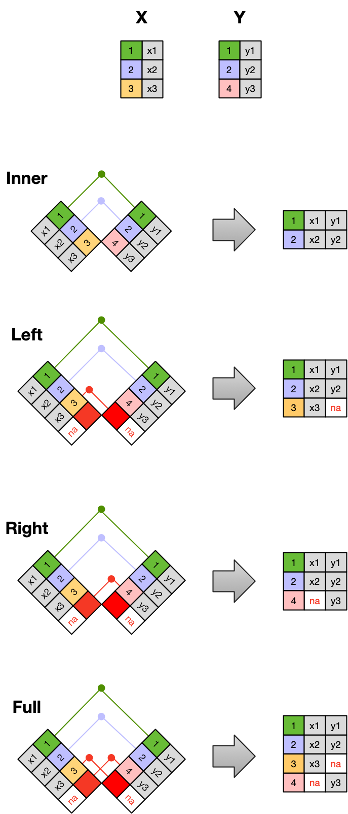

# Joins {#sec-join}

```{r}
#| include: false
source("R/booktem_setup.R")
source("R/my_setup.R")
library(tidyverse)
library(here)
```


## Join functions

Data analysis often requires merging separately managed tables back together. There are multiple ways to join the observations in two tables, based on how the rows of one table are merged with the rows of the other.

When thinking about joins, picture two tables, one on the left and one on the right. The most common (and often useful) join is when you merge the subset of rows that have matches in both the left table and the right table: this is called an INNER JOIN. Other types of join are also possible:

- A LEFT JOIN takes all of the rows from the left table, and merges on the data from matching rows in the right table. Rows in the left table with no matching key are still kept, with a missing value (NA) for the right table's columns. 

- A RIGHT JOIN is the same, except that all of the rows from the right table are included with matching data from the left, or a missing value. 

- Finally, a FULL JOIN includes all data from all rows in both tables, and includes missing values wherever necessary.

There are also two *filtering* joins, which keep or drop rows of the left table without adding any columns from the right table:

- A SEMI JOIN keeps the rows of the left table that have a match in the right table.

- An ANTI JOIN keeps the rows of the left table that have *no* match in the right table. This is very handy for finding records that are missing from a lookup table.


```{r}
#| label: join-images
#| echo: false
#| fig-alt: "Diagram of four joins between table X (keys 1, 2, 3) and table Y (keys 1, 2, 4). An inner join keeps keys 1 and 2. A left join keeps 1, 2 and 3, with NA for y3. A right join keeps 1, 2 and 4, with NA for x. A full join keeps all four keys, with NA wherever there is no match."



```


We will use two small example tables. They share an `ID` column, which we tell each join to match on with `join_by()` (dplyr 1.1.0 and later; older code uses `by = "ID"`).


```{r}
# Create tibbles df_primary and df_secondary
df_primary <- tibble(
  ID = c("A", "B", "C", "D", "F"),
  y = c(5, 5, 8, 0, 9)
)

df_secondary <- tibble(
  ID = c("A", "B", "C", "D", "E"),
  z = c(30, 21, 22, 25, 29)
)
```

### Inner join

```{r}
inner_join(df_primary, df_secondary, join_by(ID))
```

### Left join

```{r}
left_join(df_primary, df_secondary, join_by(ID))
```

### Right join

```{r}
right_join(df_primary, df_secondary, join_by(ID))
```

### Full join

```{r}
full_join(df_primary, df_secondary, join_by(ID))
```

### Semi join

```{r}
semi_join(df_primary, df_secondary, join_by(ID))
```

### Anti join

```{r}
# Which IDs in df_primary have no match in df_secondary?
anti_join(df_primary, df_secondary, join_by(ID))
```
