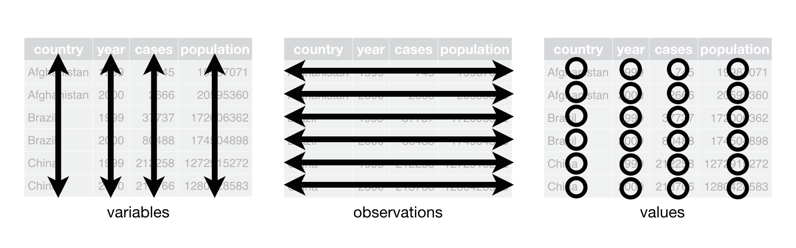
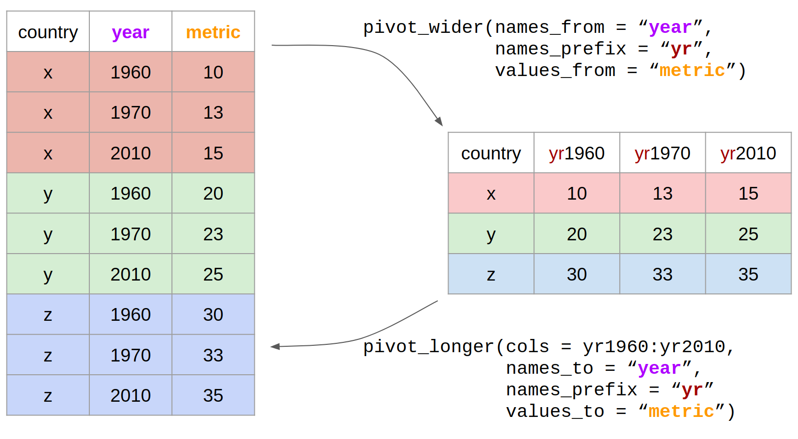

# Tidy data {#sec-tidy}

```{r}
#| include: false
source("R/booktem_setup.R")
source("R/my_setup.R")
library(tidyverse)
library(here)
```


We are going to learn how to organise data using the *tidy* format, because this is the format the `tidyverse` packages @R-tidyverse are built around. The tidyverse is an opinionated but highly effective approach to reproducible analysis, with a wide range of data manipulation tools. Tidy data is an easy format for computers to read. It is also the structure that most modelling and plotting functions in R expect.

Here 'tidy' refers to a specific structure that lets us manipulate and visualise data with ease. In a tidy dataset each *variable* is in one column and each row contains one *observation*. Each cell of the table/spreadsheet contains the *values*. You might notice that tidy data is quite long: it has a lot of rows. Tidy data is usually longer than *wide* data, so people often talk about it as *long*-format data, but the two are not quite the same thing. A dataset can be long and still untidy, for example if one column mixes two different variables.

```{r}
#| eval: true
#| echo: false
#| out-width: "80%"
#| fig-alt: "tidy data overview"

```


## Why tidy data?

- The data cleaning and analysis tools in R work best with data that is "tidy"

- "Tidy" data has a clear and consistent structure; untidy data can be "messy" in lots of different ways


## Using `pivot` functions

What do we do if the data we are working with in R isn't "tidy"?

The `tidyverse` includes functions that help us reshape data: 

* `tidyr::pivot_wider()` - from *long* to *wide* format

* `tidyr::pivot_longer()` - from *wide* to *long* format


```{r}
#| label: img-pivot-gif
#| echo: false
#| fig-cap: "Reshaping data with pivot"

knitr::include_graphics("images/tidyr-longer-wider.gif")

```


```{r}
#| eval: true
 country <- c("x", "y", "z")
 yr1960 <-  c(10, 20, 30)
 yr1970 <-  c(13, 23, 33)
 yr2010 <-  c(15, 25, 35)

country_data <- tibble(country, yr1960, yr1970, yr2010)
country_data
```


### Pivot longer

```{r}
#| label: pivot-data
#| eval: false

pivot_longer(data = country_data,
             cols = yr1960:yr2010,
             names_to = "year",
             names_prefix = "yr",
             values_to = "metric")

```

```{r}
#| label: img-pivot
#| echo: false
#| fig-cap: "Reshaping data with pivot"



```


To *save* these changes to your data format, you must assign the result to an object. You have two options:

* Use the same name as the original R object: this will *overwrite* the original with the new format

* Use a *new* name for the reformatted data: both R objects will then exist in your Environment

Neither is more *correct* than the other but be aware of what you are doing.


### Create a new R object

```{r}
#| eval: false

long_country_data <- pivot_longer(data = country_data,
             cols = yr1960:yr2010,
             names_to = "year",
             names_prefix = "yr", # optional
             values_to = "metric")

```


### Overwrite the original object 

```{r}
#| eval: false
country_data <- pivot_longer(data = country_data,
             cols = yr1960:yr2010,
             names_to = "year",
             names_prefix = "yr",
             values_to = "metric")

```

After running this, `country_data` is in long format, so the wide-format code above will no longer work on it (the `yr1960:yr2010` columns are gone). This is why we created `long_country_data` first.


### Pivot wider

Let's use the long country data we have just generated as an example of how we *could* use the `pivot_wider()` function and reverse the process:

```{r}
#| eval: false

pivot_wider(data = long_country_data,
            names_from = year,
            names_prefix = "yr",
            values_from = "metric")


```

## Reading

- [Tidy data](https://vita.had.co.nz/papers/tidy-data.pdf)
